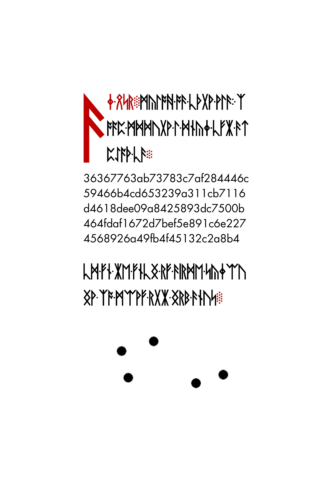
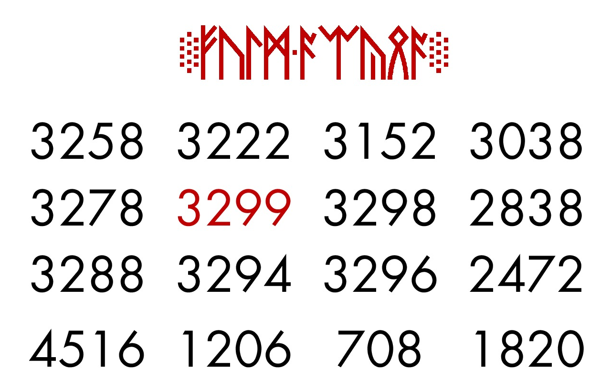
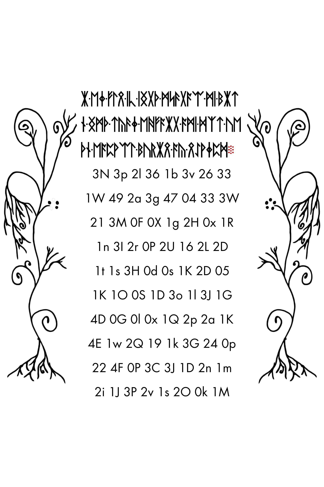
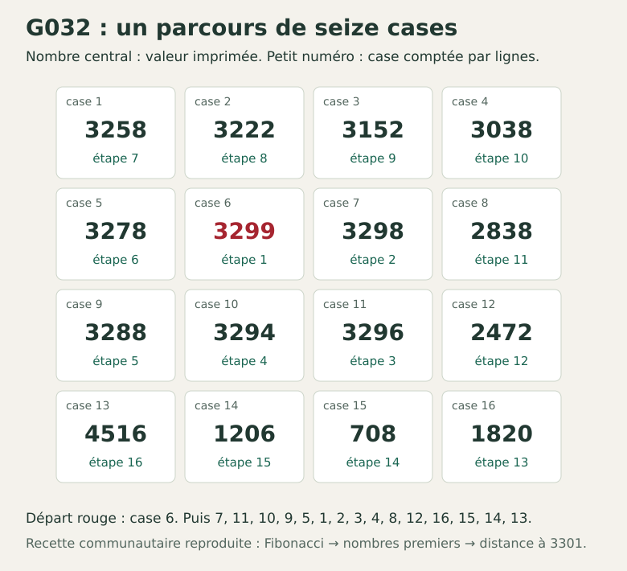
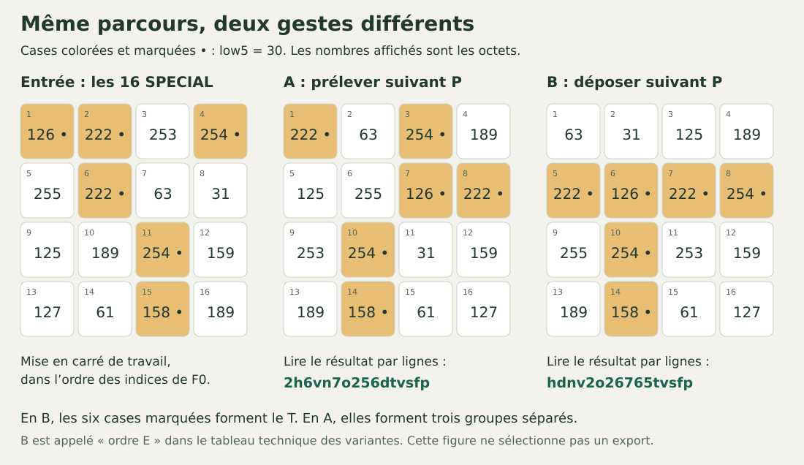
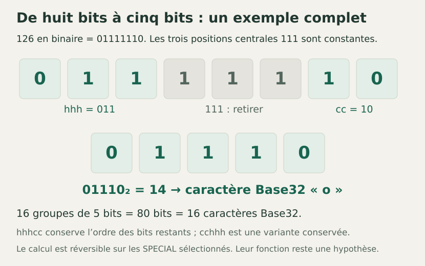

# Des pages aux deux candidats — le parcours en dix minutes

**Atelier Primus · MarcelDuSHAmp · Collaboration IA : ASTRA GPT-6**  
Lecture guidée de l’état publié le 22 octobre 2026. Aucun prérequis en cryptographie.

**La question : comment arrivons-nous à deux chaînes ressemblant à d’anciennes adresses Tor, et qu’est-ce qui reste à démontrer ?**

Nous allons suivre des objets précis : des inscriptions numériques, un fichier de 256 nombres, seize valeurs sélectionnées et un parcours dans une grille. Les calculs sont vérifiables. Leur interprétation comme chemin voulu par Cicada reste ouverte.

[Accueil](README.md) · [Démonstration technique et variantes](PISTE_ONION.md) · [Sources et crédits](ATTRIBUTION.md)

## 1. Pourquoi chercher quelque chose hors du livre ? — 1 minute

La page **G073** — appelée aussi **LP2 56.jpg** — possède un déchiffrement communautaire. Elle invite à retrouver une page du *deep web* identifiée par une empreinte : une valeur calculée à partir d’un contenu, à laquelle confronter celui que l’on retrouverait. [Source communautaire : CicadaSolvers](https://www.cicadasolvers.com/quickstart/).

Cette invitation motive une recherche extérieure. **Elle ne nomme ni Tor ni le suffixe `.onion`.** Relier une sortie numérique à ce protocole est donc une hypothèse du parcours présenté ici.

| Une invitation extérieure | Une grille de nombres | Des inscriptions à transcrire |
|---|---|---|
|  |  |  |
| **G073**, la cible à rechercher | **G032**, un précédent de parcours | **G066**, puis [G067](images/G067.jpg) et [G068](images/G068.jpg) |

Ces images viennent du corpus Liber Primus. Leur mise côte à côte montre les objets mobilisés ; elle ne prouve pas qu’ils doivent être reliés. [Atlas et provenance](ATLAS.md).

## 2. Préparer les seize valeurs — 2 minutes

**F0** est le nom de notre fichier de travail : 256 valeurs comprises entre 0 et 255, chacune tenant sur huit bits, donc un *octet*. Il provient d’une reconstruction des inscriptions de G066–G068 interprétées en base 60.

**Point de départ déclaré : cette démonstration utilise le binaire versionné. Elle ne refait pas la transcription des images.** Vérifier indépendamment cette reconstruction reste une tâche à part. [Fichier F0 retenu](calculs/r4/F0-3b9b07d9.bin) · [Versions et six différences](actualites/2026-10-22-f0.md).

On sépare chaque octet en **trois bits de gauche** (`high3`) et **cinq bits de droite** (`low5`). Cela revient à écrire `valeur = 32 × high3 + low5`.

Nous appelons **SPECIAL** les valeurs dont `low5` vaut 29, 30 ou 31. Ce nom décrit notre classement ; il ne traduit pas une instruction du livre. Le filtre retient exactement **16 valeurs** : cinq de classe 29, six de classe 30, cinq de classe 31.

| Rang dans la liste | 1 | 2 | 3 | 4 | 5 | 6 | 7 | 8 |
|---|---|---|---|---|---|---|---|---|
| Valeur | 126 | 222 | 253 | 254 | 255 | 222 | 63 | 31 |
| Rang dans la liste | **9** | **10** | **11** | **12** | **13** | **14** | **15** | **16** |
| Valeur | 125 | 189 | 254 | 159 | 127 | 61 | 158 | 189 |

La liste suit les indices croissants de F0. Les seize valeurs sont identiques dans les deux versions conservées. Cela établit leur stabilité entre ces versions, sans valider toutes les étapes de construction de F0.

## 3. Emprunter un parcours déjà documenté — 2 minutes

La grille **G032**, aussi nommée **LP2 15.jpg**, contient seize nombres. Une recette communautaire les reconstruit à partir de Fibonacci, de nombres premiers et de leur distance à 3301. Le trajet commence au **3299 rouge**, puis relie les cases par voisinage horizontal ou vertical.

**Cette recette est antérieure à notre projet.** Nous la reproduisons et testons son application aux SPECIAL ; son premier auteur reste à préciser. [Référence CicadaSolvers](https://www.cicadasolvers.com/wiki/liber-primus/lp2/15-jpg/15-jpg-square/) · [Calculs de contrôle](calculs/g032/README.md).



En numérotant les cases par lignes, de 1 à 16, le parcours est :

```text
P = 6, 7, 11, 10, 9, 5, 1, 2, 3, 4, 8, 12, 16, 15, 14, 13
```

**Le raccord proposé** consiste à appliquer ce trajet aux seize SPECIAL. Le fait d’avoir seize cases et seize valeurs rend ce test possible ; il ne suffit pas à imposer leur association.

## 4. Prélever ou déposer : le choix qui change la sortie — 2 minutes

Imagine seize cartes numérotées dans une liste, et seize places sur une table.

**A — Prélever.** Disposer les cartes par lignes, puis ramasser les valeurs dans l’ordre P. La première valeur vient de la case 6 : **222**. La deuxième vient de la case 7 : **63**.

**B — Déposer.** Prendre les cartes dans leur ordre initial, puis les placer dans les cases indiquées par P. La première valeur, **126**, va en case 6 ; la deuxième, **222**, en case 7. Lire ensuite la grille remplie par lignes.



Les deux opérations emploient le même trajet et donnent deux listes différentes. Dans le dépôt B, les six valeurs de classe 30 dessinent un T. Le prélèvement A retrouve un autre contrôle historique, appelé RIGHT/RIGHT dans le dossier. Ces précédents soutiennent des usages différents ; aucun ne sélectionne à lui seul l’export final. [Explications techniques](PISTE_ONION.md).

**Convention de nommage :** ici A et B désignent les deux cibles. Le dépôt B correspond à **l’ordre E** dans le tableau technique des six ordres. Les deux cibles restent à égalité pour la recherche d’authentification.

## 5. Garder cinq bits, puis les écrire en Base32 — 2 minutes

Les nombres 29, 30 et 31 s’écrivent `11101`, `11110` et `11111` sur cinq bits. Tous nos SPECIAL ont donc la forme **`hhh111cc`** : trois bits variables, trois bits constants, deux bits variables.

Retirer les trois positions constantes conserve **`hhhcc`**. Par exemple :



Nous obtenons **16 × 5 = 80 bits**. Base32 fournit une écriture de ces bits : chaque groupe de cinq bits désigne un caractère de l’alphabet `abcdefghijklmnopqrstuvwxyz234567`. C’est un encodage, sans clé de déchiffrement.

Ainsi, pour A, les trois premières valeurs donnent les groupes de valeurs **26, 7, 30**, puis les caractères **`2h6`**. Pour B, **7, 3, 13** donnent **`hdn`**. En continuant sur les seize éléments :

| Geste | Les 80 bits, écrits en hexadécimal | Chaîne Base32 |
|---|---|---|
| A — prélèvement | `d1fd56fddaef873ac8af` | `2h6vn7o256dtvsfp` |
| B — dépôt, puis lecture par lignes | `38db5d3b5effbb3ac8af` | `hdnv2o26765tvsfp` |

Le retrait direct conserve l’ordre des bits restants. Il motive ce geste, mais **aucune consigne finale indépendante n’impose encore `hhhcc`**. Le codage `cchhh` et d’autres ordres restent dans les [douze variantes publiées](PISTE_ONION.md).

## 6. Pourquoi ajouter `.onion`, et quelle preuve manque ? — 1 minute

L’ancien format Tor v2 emploie précisément **80 bits encodés en 16 caractères Base32**. Pour un service réel, ces bits proviennent d’une empreinte SHA-1 de sa clé publique RSA. [Tor Project, spécification historique, section 1.5](https://torproject.gitlab.io/torspec/rend-spec-v2.html).

C’est ce rapprochement qui motive nos deux **adresses candidates** :

```text
A : 2h6vn7o256dtvsfp.onion
B : hdnv2o26765tvsfp.onion
```

**Toute suite de 80 bits peut prendre cette forme.** La forme ne démontre donc ni l’existence d’un service ni son appartenance à Cicada. L’empreinte recherchée dans G073 concerne une page : elle constitue une cible distincte de ces identifiants.

| Ce que l’on sait refaire | Ce qu’il faut encore établir |
|---|---|
| Extraire les 16 SPECIAL du F0 retenu | Confirmer indépendamment la reconstruction depuis les images |
| Rejouer G032, le prélèvement et le dépôt | Justifier le transfert de ce parcours à cet objet |
| Reproduire les deux chaînes et les variantes | Départager le geste, le sens et la disposition des bits |
| Reconnaître un format compatible Tor v2 | Retrouver une trace historique authentifiée, puis un lien avec Cicada |

Une clé publique RSA historique ou un descripteur dont l’identifiant recalculé correspond exactement à A ou B serait une preuve matérielle importante. Il faudrait aussi contrôler sa provenance ; le lien avec Cicada resterait une question distincte. **L’état publié ne fournit pas cette authentification.**

## Vérifier soi-même ou proposer une réfutation

Depuis la racine du dépôt téléchargé, avec Python 3 et sa bibliothèque standard :

```bash
python3 calculs/verifier_dossier.py
python3 calculs/reproduire_onion.py
```

La première commande contrôle notamment les empreintes des images et les versions F0 ; la seconde rejoue les douze variantes et vérifie l’inversion du codage. Elles travaillent hors réseau. Le succès du programme vérifie les calculs sous ces conventions, pas l’interprétation du livre. [Guide complet](REPRODUCTION.md).

Pour un retour utile, indiquer **l’étape concernée, les données utilisées, le calcul refait et l’erreur ou l’alternative observée**. Un précédent antérieur accompagné de sa source est également précieux.

**Crédits.** Images : corpus Cicada 3301 et auteurs des œuvres incorporées. Déchiffrement de G073 et recette G032 : travaux communautaires antérieurs. Mise en relation, contrôles et présentation : travaux consignés dans Atelier Primus ; priorité extérieure non établie. Les trois schémas sont générés depuis les données versionnées par [ce script](outils/generer_parcours.py). [Attributions détaillées](ATTRIBUTION.md) · [Droits](DROITS.md).
