# Arborescence fonctionnelle des recherches

**MarcelDuSHAmp · Collaboration IA : ASTRA GPT-6**

[Accueil de l’architecture](README.md) · [Données du graphe](graphe-fonctionnel.json) · [Sources et limites du rejeu](SOURCES.md)

**12 circuits · 96 objets ou fonctions · 138 liaisons typées · 171 fiches rattachées.**

Graphe des circuits documentés dans cette édition :171 fiches et audits A01–A05. Les rapports non distribués sont identifiés par empreinte. Ce graphe n’est ni une VM exécutable, ni un inventaire exhaustif des archives privées.

Les flèches représentent les relations décrites dans les tables. Une flèche de calcul indique une composition définie sous nos paramètres, pas une instruction enseignée par le livre. Les choix de cible, de type, d’unité ou d’opération restent explicitement hypothétiques. Les circuits graphiques sont locaux ; leurs raccords extérieurs sont recensés juste après chaque schéma.

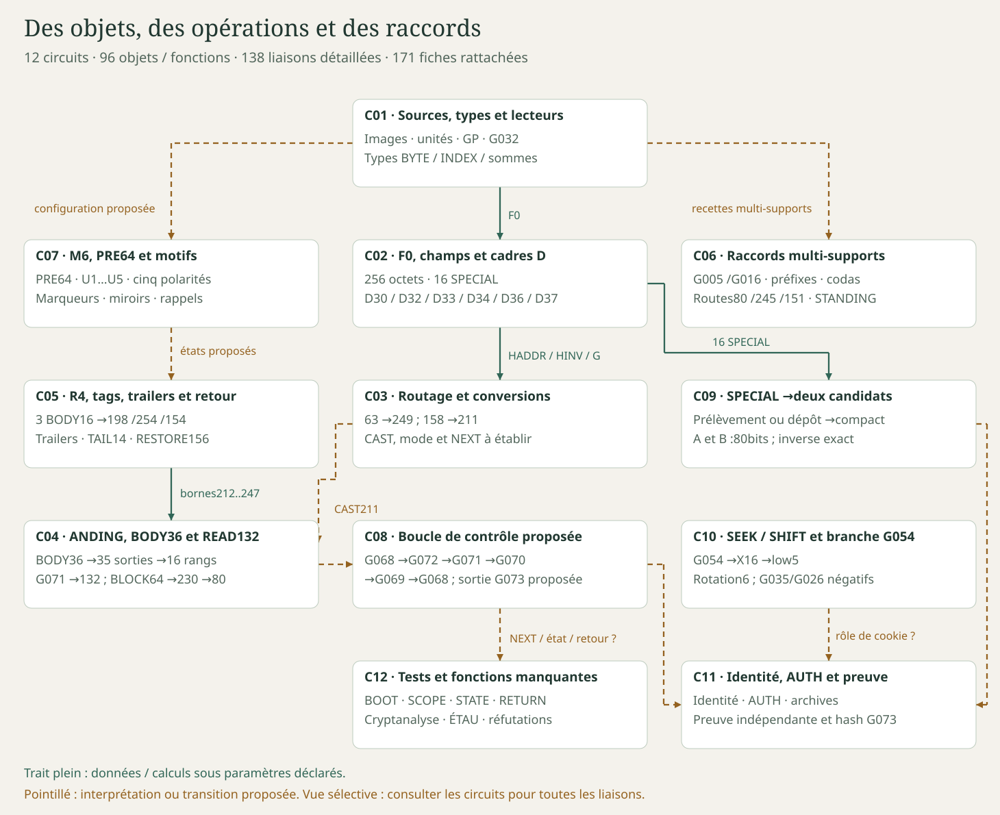

## Légende

| Relation | Sens |
|---|---|
| CALCUL | Calcul défini sous les paramètres annoncés ; le niveau de rejeu figure dans les nœuds. |
| DONNEE | Donnée fournie à un calcul ou sous-objet extrait ; pas une instruction du livre. |
| HYPOTHESE | Choix de cible, opération ou sens fonctionnel proposé ; transition non commandée par LP. |
| ALTERNATIVE | Recette concurrente ou convergence ; aucun ordre d’exécution impliqué. |
| REFUTE | Règle ou rôle précis contredit dans le périmètre indiqué. |
| MANQUANT | Fonction ou preuve nécessaire encore absente. |
| CONTEXTE | Rapprochement documentaire ; aucune circulation de données ni exécution affirmée. |

Les lignes pleines représentent données/calculs ; les pointillés les hypothèses, alternatives ou fonctions manquantes ; une croix termine les branches réfutées. Les liens de contexte sont sans flèche. Chaque liaison garde un identifiant E stable dans cette édition.

**Rejeu :** « local » signale les calculs/fichiers couverts par les scripts distribués ; les interprétations et résultats historiques cités dans la même notice restent attribués à leurs rapports. « rapport » signifie qu’aucune nouvelle transcription ni campagne n’a été effectuée pour cette carte. Voir les limites détaillées de [SOURCES.md](SOURCES.md).

## Accès aux circuits

| Circuit | Fonction étudiée |
|---|---|
| [C01](#c01) | Sources, types et lecteurs — Définir le matériau et les unités avant toute transformation. |
| [C02](#c02) | F0, champs et cadres D — Séparer table, champs, événements SPECIAL et payloads. |
| [C03](#c03) | Routage et conversions — Montrer les deux voies vers 211 et les casts encore choisis. |
| [C04](#c04) | ANDING, BODY36 et READ132 — La composition de sélection et ses destinations candidates. |
| [C05](#c05) | R4, tags, trailers et retour — Distinguer le lecteur lexical, les résidus et un éventuel état. |
| [C06](#c06) | Raccords multi-supports — Conserver les routes concurrentes sans imposer leur ordre. |
| [C07](#c07) | M6, PRE64 et configuration graphique — Ne pas réduire les cinq unités et les motifs à un rôle déjà acquis. |
| [C08](#c08) | Boucle de contrôle proposée — Conserver le scénario P01 en rendant explicite chaque transition non démontrée. |
| [C09](#c09) | SPECIAL →deux candidats — Deux gestes concurrents et une compression inversible. |
| [C10](#c10) | SEEK / SHIFT et branche G054 — La seconde voie d’export et ses échecs de généralisation. |
| [C11](#c11) | Identité, autorisation et preuve extérieure — Séparer les tailles compatibles des fonctions d’accès démontrées. |
| [C12](#c12) | Branches de recherche et verrous VM — Rattacher aussi les campagnes négatives et les fonctions absentes. |

## C01

**Sources, types et lecteurs** — Définir le matériau et les unités avant toute transformation.

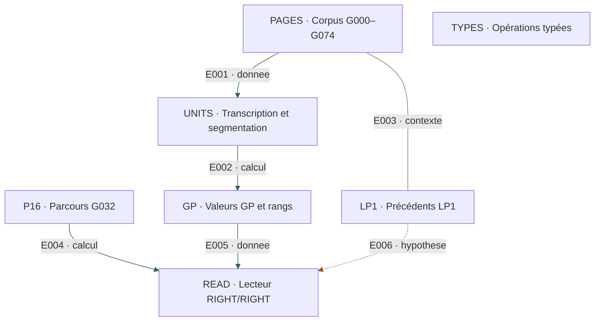

### Objets, opérations et limites

| ID / objet | Entrée | Opération | Sortie | Limite et provenance |
|---|---|---|---|---|
| **PAGES** — Corpus G000–G074 | 75 JPEG attribués à Cicada et œuvres incorporées | Repérage global ; contrôle des empreintes | LP1 G000–G016 ; LP2 G017–G074 | Le numéro G est notre convention, pas une adresse du livre. Niveau : local. [SRC-001](../recherches/01-sources-et-conventions.md#src-001) · [SRC-002](../recherches/01-sources-et-conventions.md#src-002) · [SRC-007](../recherches/01-sources-et-conventions.md#src-007) |
| **UNITS** — Transcription et segmentation | Runes, espaces, fins de ligne, couleurs | Distinguer groupe physique et mot lexical | Deux segmentations ; G067 hors flux runique | Les changements d’unité doivent être annoncés ; transcriptions secondaires créditées. Niveau : rapport. [SRC-003](../recherches/01-sources-et-conventions.md#src-003) · [SRC-004](../recherches/01-sources-et-conventions.md#src-004) · [SRC-006](../recherches/01-sources-et-conventions.md#src-006) |
| **GP** — Valeurs GP et rangs | Rune identifiée | GP premier ; rang base 0 ou base 1 ; somme puis réduction explicite | GP_SUM et RANK_SUM distincts | Un même entier n’est pas une preuve d’adressage. Niveau : rapport. [SRC-005](../recherches/01-sources-et-conventions.md#src-005) · [ERR-008](../recherches/10-contre-epreuves-et-corrections.md#err-008) |
| **LP1** — Précédents LP1 | Pages déjà résolues et archives communautaires | Inversion, continuité, clés, extraction JPEG, XOR/compression | Répertoire de gestes transmis par des solutions antérieures | Ces solutions sont antérieures au projet ; transfert LP2 à justifier. Niveau : rapport. [LP1-001](../recherches/02-apprentissage-et-precedents.md#lp1-001) · [LP1-002](../recherches/02-apprentissage-et-precedents.md#lp1-002) · [LP1-003](../recherches/02-apprentissage-et-precedents.md#lp1-003) · [LP1-004](../recherches/02-apprentissage-et-precedents.md#lp1-004) · [LP1-005](../recherches/02-apprentissage-et-precedents.md#lp1-005) · [LP1-006](../recherches/02-apprentissage-et-precedents.md#lp1-006) · [LP1-007](../recherches/02-apprentissage-et-precedents.md#lp1-007) · [LP1-008](../recherches/02-apprentissage-et-precedents.md#lp1-008) · [LP1-009](../recherches/02-apprentissage-et-precedents.md#lp1-009) · [LP1-010](../recherches/02-apprentissage-et-precedents.md#lp1-010) · [LP1-011](../recherches/02-apprentissage-et-precedents.md#lp1-011) · [LP1-012](../recherches/02-apprentissage-et-precedents.md#lp1-012) |
| **P16** — Parcours G032 | Grille et recette communautaire premiers/Fibonacci/distance 3301 | Reconstruction du parcours, puis emploi d’une permutation fixée | P=[6,7,11,10,9,5,1,2,3,4,8,12,16,15,14,13] | La recette et les solutions antérieures restent attribuées aux solveurs. Niveau : local. [R4-001](../recherches/07-r4-et-lecteur-spatial.md#r4-001) · [ATTR](../ATTRIBUTION.md) |
| **READ** — Lecteur RIGHT/RIGHT | 16 objets ordonnés et une unité déclarée | Prélèvement P ; colonne droite ; finale des groupes ; somme GP | Finales des objets source 10,2,12,13 | Le lecteur ne décide ni la cible, ni la segmentation, ni NEXT. Niveau : local. [R4-002](../recherches/07-r4-et-lecteur-spatial.md#r4-002) · [R4-016](../recherches/07-r4-et-lecteur-spatial.md#r4-016) |
| **TYPES** — Opérations typées | BYTE, INDEX, GP_SUM, RANK_SUM, liste | HADDR(b)=8*(b&31)+(b>>5) ; HINV(i)=((i&7)<<5) / (i>>3) ; G=F0∘HADDR | HADDR : BYTE→INDEX ; HINV : INDEX→BYTE ; G : BYTE→BYTE | HINV(158)=211 ne donne pas automatiquement le PC 211. Niveau : local. [F0-003](../recherches/06-f0-familles-d-et-routage.md#f0-003) · [A01](SOURCES.md) |

### Liaisons internes

| ID | De → vers | Relation | Contrat / limite | Source |
|---|---|---|---|---|
| E001 | PAGES ([C01](#c01)) → UNITS ([C01](#c01)) | DONNEE | Transcription selon les unités du protocole | [SRC-003](../recherches/01-sources-et-conventions.md#src-003) · [SRC-006](../recherches/01-sources-et-conventions.md#src-006) |
| E002 | UNITS ([C01](#c01)) → GP ([C01](#c01)) | CALCUL | Valoriser chaque rune avec la convention déclarée | [SRC-005](../recherches/01-sources-et-conventions.md#src-005) |
| E003 | PAGES ([C01](#c01)) → LP1 ([C01](#c01)) | CONTEXTE | Solutions historiques : précédent, non instruction LP2 | [LP1-012](../recherches/02-apprentissage-et-precedents.md#lp1-012) |
| E004 | P16 ([C01](#c01)) → READ ([C01](#c01)) | CALCUL | Fixer les quatre positions source du readout | [R4-002](../recherches/07-r4-et-lecteur-spatial.md#r4-002) |
| E005 | GP ([C01](#c01)) → READ ([C01](#c01)) | DONNEE | Valeurs des finales ; somme GP | [R4-002](../recherches/07-r4-et-lecteur-spatial.md#r4-002) |
| E006 | LP1 ([C01](#c01)) → READ ([C01](#c01)) | HYPOTHESE | Transférer un geste appris à un nouvel objet | [LP1-012](../recherches/02-apprentissage-et-precedents.md#lp1-012) |

### Raccords avec les autres circuits

| ID | De → vers | Relation | Contrat / limite | Source |
|---|---|---|---|---|
| E095 | PAGES ([C01](#c01)) → F0 ([C02](#c02)) | DONNEE | Inscriptions numériques G066–G068 | [F0-001](../recherches/06-f0-familles-d-et-routage.md#f0-001) |
| E096 | F0 ([C02](#c02)) → TYPES ([C01](#c01)) | DONNEE | F0 est la table employée par G | [F0-003](../recherches/06-f0-familles-d-et-routage.md#f0-003) |
| E097 | TYPES ([C01](#c01)) → D32 ([C03](#c03)) | CALCUL | Appliquer HADDR à63 | [A01](SOURCES.md) |
| E103 | READ ([C01](#c01)) → ANDING ([C04](#c04)) | HYPOTHESE | Appliquer le lecteur aux16 groupes physiques G068 | [LNK-004](../recherches/08-raccords-multi-supports.md#lnk-004) |
| E104 | READ ([C01](#c01)) → ABC ([C05](#c05)) | HYPOTHESE | Appliquer le lecteur aux BODY lexicaux R4 | [R4-005](../recherches/07-r4-et-lecteur-spatial.md#r4-005) |
| E105 | READ ([C01](#c01)) → READ132 ([C04](#c04)) | HYPOTHESE | Réduire les16 mots sélectionnés | [P02](../pieces/LP_READ_CHECKPOINT_20261021.md) |
| E106 | READ ([C01](#c01)) → BLOCK64 ([C04](#c04)) | HYPOTHESE | Réduire16 cases de4 mots | [A01](SOURCES.md) |
| E111 | P16 ([C01](#c01)) → TAKE ([C09](#c09)) | DONNEE | Même permutation P | [A01](SOURCES.md) |
| E112 | P16 ([C01](#c01)) → PLACE ([C09](#c09)) | DONNEE | Même permutation P, geste inverse | [A01](SOURCES.md) |

## C02

**F0, champs et cadres D** — Séparer table, champs, événements SPECIAL et payloads.

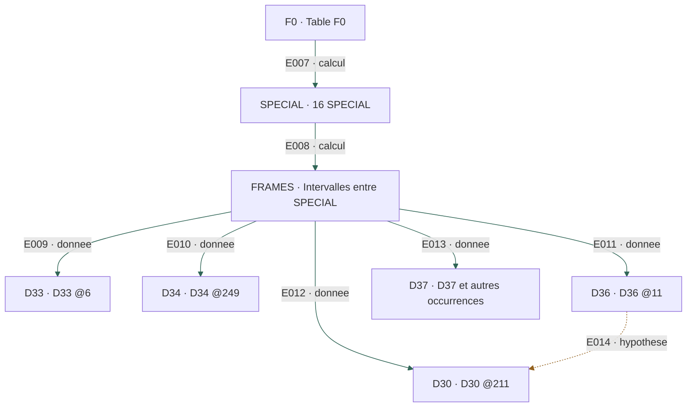

### Objets, opérations et limites

| ID / objet | Entrée | Opération | Sortie | Limite et provenance |
|---|---|---|---|---|
| **F0** — Table F0 | 256 tokens numériques G066–G068 | Reconstruction et version par SHA-256 | 32×8 octets ; deux binaires distribués ; six indices différents | 3b9b07d9 autorité A01 ; 0201348c conservé ; G(112)=120/144. Niveau : local. [F0-001](../recherches/06-f0-familles-d-et-routage.md#f0-001) · [SRC-008](../recherches/01-sources-et-conventions.md#src-008) · [ERR-003](../recherches/10-contre-epreuves-et-corrections.md#err-003) · [A01](SOURCES.md) |
| **SPECIAL** — 16 SPECIAL | Chaque octet de F0 | high3=b>>5 ; low5=b&31 ; retenir low5≥29 | 16 positions ; classes 29/30/31 : 5/6/5 | D=high3+low5 n’est pas un opcode unique ; préciser valeur et index. Niveau : local. [F0-002](../recherches/06-f0-familles-d-et-routage.md#f0-002) · [F0-004](../recherches/06-f0-familles-d-et-routage.md#f0-004) |
| **FRAMES** — Intervalles entre SPECIAL | Positions des 16 SPECIAL | Découper les 15 intérieurs, hors bornes | Tailles 4,36,7,8,30,8,0,37,6,18,23,11,4,37,4 | Aucun intérieur de 16 ; le parseur ne sépare pas automatiquement body/footer. Niveau : local. [F0-005](../recherches/06-f0-familles-d-et-routage.md#f0-005) · [F0-007](../recherches/06-f0-familles-d-et-routage.md#f0-007) · [A01](SOURCES.md) |
| **D33** — D33 @6 | Entrée 126 ; intérieur indices 7..10 | Payload [183,92,249,156] ; AND et G élémentaire | AND=16 ; G=[192,73,21,144] ; sommes mod256=168/174 | 168→174 résume deux vecteurs ; ce n’est pas une fonction scalaire démontrée. Niveau : local. [F0-012](../recherches/06-f0-familles-d-et-routage.md#f0-012) · [A01](SOURCES.md) |
| **D34** — D34 @249 | Entrée 158 ; intérieur indices 250..253 | Payload [172,230,180,36] ; AND ; G | AND=36 ; G=[229,80,18,114] | 158 est l’entrée, pas le premier octet du payload ; choix de 230 non commandé. Niveau : local. [F0-005](../recherches/06-f0-familles-d-et-routage.md#f0-005) · [A01](SOURCES.md) |
| **D36** — D36 @11 | Bornes 11 et 48 | 36 octets internes ; tête [247,4,183,212] | Candidats 212..247 ; G(183)=192=F0[247] | D36 désigne aussi d’autres valeurs ; ce cadre n’est pas BODY36. Niveau : local. [F0-007](../recherches/06-f0-familles-d-et-routage.md#f0-007) · [F0-008](../recherches/06-f0-familles-d-et-routage.md#f0-008) |
| **D30** — D30 @211 | Entrée 61 ; intérieur jusqu’à D34 @249 | BODY212..247 ; élément 248=113 | 36 octets BODY ; somme 4551→199 ; 37 ordinaires avec 113 | Le rôle de footer de 113 reste proposé. Niveau : local. [F0-009](../recherches/06-f0-familles-d-et-routage.md#f0-009) · [A01](SOURCES.md) |
| **D37** — D37 et autres occurrences | 254 aux indices 56 et170 ; autres SPECIAL | Inventaire des positions et des intervalles | Objets adressables dans notre modèle | Portée, décodeur et fonction d’instruction non déterminés. Niveau : local. [F0-018](../recherches/06-f0-familles-d-et-routage.md#f0-018) · [A01](SOURCES.md) |

### Liaisons internes

| ID | De → vers | Relation | Contrat / limite | Source |
|---|---|---|---|---|
| E007 | F0 ([C02](#c02)) → SPECIAL ([C02](#c02)) | CALCUL | Extraire high3/low5 et filtrer low5≥29 | [F0-002](../recherches/06-f0-familles-d-et-routage.md#f0-002) |
| E008 | SPECIAL ([C02](#c02)) → FRAMES ([C02](#c02)) | CALCUL | Ordre physique des bornes | [A01](SOURCES.md) |
| E009 | FRAMES ([C02](#c02)) → D33 ([C02](#c02)) | DONNEE | Cadre local identifié par index et valeur | [A01](SOURCES.md) |
| E010 | FRAMES ([C02](#c02)) → D34 ([C02](#c02)) | DONNEE | Cadre local identifié par index et valeur | [A01](SOURCES.md) |
| E011 | FRAMES ([C02](#c02)) → D36 ([C02](#c02)) | DONNEE | Cadre local identifié par index et valeur | [A01](SOURCES.md) |
| E012 | FRAMES ([C02](#c02)) → D30 ([C02](#c02)) | DONNEE | Cadre local identifié par index et valeur | [A01](SOURCES.md) |
| E013 | FRAMES ([C02](#c02)) → D37 ([C02](#c02)) | DONNEE | Cadre local identifié par index et valeur | [A01](SOURCES.md) |
| E014 | D36 ([C02](#c02)) → D30 ([C02](#c02)) | HYPOTHESE | Lire 212 et247 comme bornes de l’autre BODY36 | [F0-008](../recherches/06-f0-familles-d-et-routage.md#f0-008) |

### Raccords avec les autres circuits

| ID | De → vers | Relation | Contrat / limite | Source |
|---|---|---|---|---|
| E087 | D30 ([C02](#c02)) → BUFFER199 ([C03](#c03)) | CALCUL | Somme4551 mod256=199 | [F0-006](../recherches/06-f0-familles-d-et-routage.md#f0-006) · [A01](SOURCES.md) |
| E088 | BUFFER199 ([C03](#c03)) → D34 ([C02](#c02)) | HYPOTHESE | Réinterprétation199→230 puis raccord au payload | [F0-006](../recherches/06-f0-familles-d-et-routage.md#f0-006) |
| E089 | GCHAINS ([C03](#c03)) → D33 ([C02](#c02)) | CALCUL | 126 est la valeur de l’entrée D33 | [F0-014](../recherches/06-f0-familles-d-et-routage.md#f0-014) |
| E095 | PAGES ([C01](#c01)) → F0 ([C02](#c02)) | DONNEE | Inscriptions numériques G066–G068 | [F0-001](../recherches/06-f0-familles-d-et-routage.md#f0-001) |
| E096 | F0 ([C02](#c02)) → TYPES ([C01](#c01)) | DONNEE | F0 est la table employée par G | [F0-003](../recherches/06-f0-familles-d-et-routage.md#f0-003) |
| E098 | D34 ([C02](#c02)) → INV158 ([C03](#c03)) | DONNEE | Entrée158 | [A01](SOURCES.md) |
| E099 | D34 ([C02](#c02)) → PHI230 ([C03](#c03)) | HYPOTHESE | Sélection du second octet interne230 | [A01](SOURCES.md) |
| E100 | CAST211 ([C03](#c03)) → D30 ([C02](#c02)) | HYPOTHESE | Lire le résultat comme index211 | [A01](SOURCES.md) |
| E101 | D33 ([C02](#c02)) → MASK16 ([C04](#c04)) | CALCUL | AND du payload donne16 | [A01](SOURCES.md) |
| E102 | D30 ([C02](#c02)) → VEC35 ([C04](#c04)) | CALCUL | G élémentaire sur BODY36 | [A01](SOURCES.md) |
| E107 | BOUNDS ([C05](#c05)) → D30 ([C02](#c02)) | HYPOTHESE | Employer les bornes calculées pour ce cadre | [F0-009](../recherches/06-f0-familles-d-et-routage.md#f0-009) |
| E109 | TRAILERS ([C05](#c05)) → D33 ([C02](#c02)) | HYPOTHESE | Les deux premiers trailers rejoignent D33, pas le troisième | [R4-010](../recherches/07-r4-et-lecteur-spatial.md#r4-010) |
| E110 | SPECIAL ([C02](#c02)) → RAW16 ([C09](#c09)) | CALCUL | Lire les16 valeurs dans l’ordre physique | [A01](SOURCES.md) |
| E123 | STARS ([C07](#c07)) → D34 ([C02](#c02)) | HYPOTHESE | Deux voies graphiques associées aux quatre octets | [VIS-012](../recherches/04-images-dessins-et-marqueurs.md#vis-012) |

## C03

**Routage et conversions** — Montrer les deux voies vers 211 et les casts encore choisis.

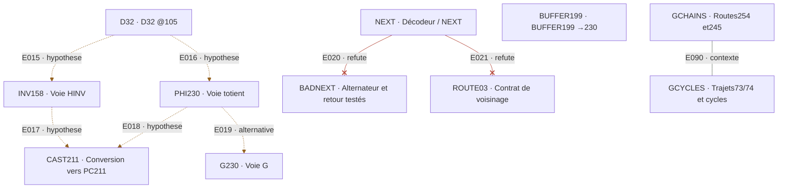

### Objets, opérations et limites

| ID / objet | Entrée | Opération | Sortie | Limite et provenance |
|---|---|---|---|---|
| **D32** — D32 @105 | F0[105]=63 ; SPECIAL suivant à106 | HADDR(63) | INDEX 249 | Intérieur vide ; aucun retour sauvegardé établi. Niveau : local. [F0-003](../recherches/06-f0-familles-d-et-routage.md#f0-003) · [A01](SOURCES.md) |
| **INV158** — Voie HINV | Entrée D34 : 158 | HINV(158) | BYTE 211 = champs 6 et19 | L’entrée est traitée comme INDEX ; le résultat doit être recasté pour adresser F0. Niveau : local. [A01](SOURCES.md) |
| **PHI230** — Voie totient | 230 sélectionné dans D34 | φ(230)=88 ; F0[88] | BYTE 211 | Le choix de 230 et la promotion de 211 en adresse restent proposés. Niveau : local. [ERR-001](../recherches/10-contre-epreuves-et-corrections.md#err-001) · [A01](SOURCES.md) |
| **G230** — Voie G | BYTE 230 | HADDR(230)=55 ; F0[55] | BYTE 80 | Même entrée, autre opération et autre sortie ; aucun sélecteur de mode connu. Niveau : local. [A01](SOURCES.md) |
| **CAST211** — Conversion vers PC211 | Valeur numérique 211 | Interpréter comme index puis lire F0[211] | Entrée61 du cadre D30 | Ce CAST n’est pas une instruction extraite de LP. Niveau : rapport. [A01](SOURCES.md) |
| **NEXT** — Décodeur / NEXT | Objet, contexte, mode et état | Choisir instruction, type et destination avant de regarder la cible | Non reconstruit | Huit NEXT uniformes échouent sur105→249→211→6. Niveau : rapport. [A01](SOURCES.md) |
| **BADNEXT** — Alternateur et retour testés | Chaîne proposée à partir de105 | HADDR / HINV / HADDR ; essais de retour à254 | 105→249→211→233 ; pas6 ; pas de106 restauré | Réfutation des règles testées, pas de toute VM possible. Niveau : local. [A01](SOURCES.md) |
| **ROUTE03** — Contrat de voisinage | SPECIAL @6, @206, @106 | HINV, HINV, HADDR selon le contrat A02 | Cibles207,239,248 : octets21,173,113 ; 0 SPECIAL /3 | Cibles déjà explorées ; ce n’est pas un nouvel essai strictement aveugle. Niveau : local. [A02](SOURCES.md) |
| **BUFFER199** — BUFFER199 →230 | Somme BODY36 modulo256=199, champs6 / 7 | Réinterpréter les deux champs en7 / 6 | 230, présent dans D34 | Échanger des champs de largeurs différentes est une convention, non une commande. Niveau : rapport. [F0-006](../recherches/06-f0-familles-d-et-routage.md#f0-006) |
| **GCHAINS** — Routes254 et245 | Valeurs254 et245 | Itérer G | 254→192→126 ;245→18→125→121 | DISPATCH est un nom proposé ;121 est le token base60 «21», pas l’octet21. Niveau : rapport. [F0-014](../recherches/06-f0-familles-d-et-routage.md#f0-014) · [F0-015](../recherches/06-f0-familles-d-et-routage.md#f0-015) |
| **GCYCLES** — Trajets73/74 et cycles | Anciens départs66/184 ;U5 corrigé83 | Parcourir le graphe fini de G | Cycles11 et2 rapportés ; trajets partageant des arcs | Un cycle de fonction finie ne prouve pas une boucle de programme. Niveau : rapport. [F0-017](../recherches/06-f0-familles-d-et-routage.md#f0-017) · [ERR-005](../recherches/10-contre-epreuves-et-corrections.md#err-005) |

### Liaisons internes

| ID | De → vers | Relation | Contrat / limite | Source |
|---|---|---|---|---|
| E015 | D32 ([C03](#c03)) → INV158 ([C03](#c03)) | HYPOTHESE | 249 est exact ; sélectionner l’entrée158 et inverser les champs reste un choix | [A01](SOURCES.md) |
| E016 | D32 ([C03](#c03)) → PHI230 ([C03](#c03)) | HYPOTHESE | 249 est exact ; sélectionner230 dans le payload reste un choix | [A01](SOURCES.md) |
| E017 | INV158 ([C03](#c03)) → CAST211 ([C03](#c03)) | HYPOTHESE | BYTE211→INDEX211 : conversion non commandée | [A01](SOURCES.md) |
| E018 | PHI230 ([C03](#c03)) → CAST211 ([C03](#c03)) | HYPOTHESE | BYTE211→INDEX211 : même lacune de type | [A01](SOURCES.md) |
| E019 | PHI230 ([C03](#c03)) → G230 ([C03](#c03)) | ALTERNATIVE | Sur le même230, remplacer φ puis F0 par G | [A01](SOURCES.md) |
| E020 | NEXT ([C03](#c03)) → BADNEXT ([C03](#c03)) | REFUTE | Alternateur proposé contredit à la troisième transition | [A01](SOURCES.md) |
| E021 | NEXT ([C03](#c03)) → ROUTE03 ([C03](#c03)) | REFUTE | Adjacence / taille4 ne choisissent pas les bonnes cibles dans ce contrat | [A02](SOURCES.md) |
| E090 | GCHAINS ([C03](#c03)) → GCYCLES ([C03](#c03)) | CONTEXTE | Routes locales dans une même fonction finie | [F0-017](../recherches/06-f0-familles-d-et-routage.md#f0-017) |

### Raccords avec les autres circuits

| ID | De → vers | Relation | Contrat / limite | Source |
|---|---|---|---|---|
| E087 | D30 ([C02](#c02)) → BUFFER199 ([C03](#c03)) | CALCUL | Somme4551 mod256=199 | [F0-006](../recherches/06-f0-familles-d-et-routage.md#f0-006) · [A01](SOURCES.md) |
| E088 | BUFFER199 ([C03](#c03)) → D34 ([C02](#c02)) | HYPOTHESE | Réinterprétation199→230 puis raccord au payload | [F0-006](../recherches/06-f0-familles-d-et-routage.md#f0-006) |
| E089 | GCHAINS ([C03](#c03)) → D33 ([C02](#c02)) | CALCUL | 126 est la valeur de l’entrée D33 | [F0-014](../recherches/06-f0-familles-d-et-routage.md#f0-014) |
| E097 | TYPES ([C01](#c01)) → D32 ([C03](#c03)) | CALCUL | Appliquer HADDR à63 | [A01](SOURCES.md) |
| E098 | D34 ([C02](#c02)) → INV158 ([C03](#c03)) | DONNEE | Entrée158 | [A01](SOURCES.md) |
| E099 | D34 ([C02](#c02)) → PHI230 ([C03](#c03)) | HYPOTHESE | Sélection du second octet interne230 | [A01](SOURCES.md) |
| E100 | CAST211 ([C03](#c03)) → D30 ([C02](#c02)) | HYPOTHESE | Lire le résultat comme index211 | [A01](SOURCES.md) |
| E119 | G230 ([C03](#c03)) → TARGET ([C10](#c10)) | MANQUANT | 80 reste une valeur sans destinataire commandé | [A01](SOURCES.md) |
| E132 | NEXT ([C03](#c03)) → SCOPE ([C12](#c12)) | MANQUANT | Instruction de choix du mode /type /unité | [A01](SOURCES.md) |
| E133 | ROUTE03 ([C03](#c03)) → COUNTER ([C12](#c12)) | REFUTE | Contrat de routage falsifié0/3 | [A02](SOURCES.md) |
| E134 | BADNEXT ([C03](#c03)) → COUNTER ([C12](#c12)) | REFUTE | Alternateur /retour testés contredits | [A01](SOURCES.md) |

## C04

**ANDING, BODY36 et READ132** — La composition de sélection et ses destinations candidates.

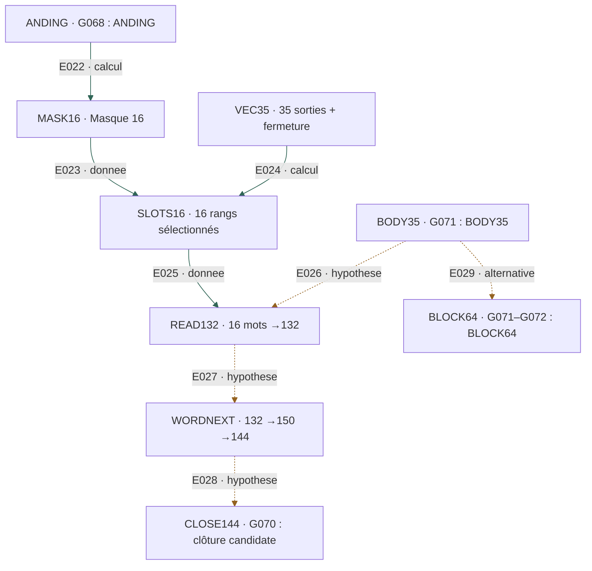

### Objets, opérations et limites

| ID / objet | Entrée | Opération | Sortie | Limite et provenance |
|---|---|---|---|---|
| **ANDING** — G068 : ANDING | 16 premiers groupes physiques | G032 RIGHT/RIGHT ; GP et rangs base1 | A,N,D,ING ; GP294→38 ; rangs81 | G068 entier =92 runes/23 groupes ; le checkpoint30 n’est pas toute la page. Niveau : rapport. [LNK-004](../recherches/08-raccords-multi-supports.md#lnk-004) · [A01](SOURCES.md) |
| **MASK16** — Masque 16 | D33 : quatre octets ; autre raccord GP38 | AND(D33)=16 ; G(38)=16 | Valeur16 par deux constructions | La convergence ne désigne pas à elle seule l’opcode AND ni son opérande. Niveau : local. [F0-012](../recherches/06-f0-familles-d-et-routage.md#f0-012) · [A01](SOURCES.md) |
| **VEC35** — 35 sorties + fermeture | BODY36 de D30 | G sur chacun des36 octets | 35 ordinaires puis126 ; somme mod25633/4 selon F0 | Les vecteurs ne sont pas identiques entre les deux F0. Niveau : local. [F0-010](../recherches/06-f0-familles-d-et-routage.md#f0-010) · [F0-011](../recherches/06-f0-familles-d-et-routage.md#f0-011) · [A01](SOURCES.md) |
| **SLOTS16** — 16 rangs sélectionnés | 35 premières sorties ; masque16 | Retenir les rangs dont (octet &16)≠0 | 2,3,5,6,8,10,14,16,19,20,25,27,28,31,34,35 | Mêmes rangs dans les deux binaires distribués ; ne pas généraliser à tous les F0. Niveau : local. [A01](SOURCES.md) · [P02](../pieces/LP_READ_CHECKPOINT_20261021.md) |
| **BODY35** — G071 : BODY35 | Deux mots-frontières GP199 | Délimitation du corps lexical | 35 mots /157 runes | La correspondance ordinal↔mot est choisie ; pas une instruction déchiffrée. Niveau : rapport. [R4-014](../recherches/07-r4-et-lecteur-spatial.md#r4-014) · [P02](../pieces/LP_READ_CHECKPOINT_20261021.md) |
| **READ132** — 16 mots →132 | BODY35 et les16 rangs du masque | Sélection puis G032 RIGHT/RIGHT | 61 runes ; finales37+37+17+41=132 | Transcription et70 alignements rapportés ; pas un nouveau rejeu runique ici. Niveau : rapport. [A01](SOURCES.md) · [P02](../pieces/LP_READ_CHECKPOINT_20261021.md) |
| **WORDNEXT** — 132 →150 →144 | Mot GP132 dans R4 ; mot suivant | Raccord par somme ; NEXT lexical ; G(150) | Mot15 GP132 ; mot16 GP150 ; G150=144 | Cible et NEXT connus après exploration ; pas de consommateur autonome prouvé. Niveau : rapport. [P02](../pieces/LP_READ_CHECKPOINT_20261021.md) |
| **CLOSE144** — G070 : clôture candidate | Bloc noir16 groupes ; coda rouge lexicale | READ bloc noir=150 ; coda150 puis144 | 144=4 / 16 ; interprétation16 entrées /4 sorties | 14 mots lexicaux dans le bloc noir ;150 se scinde41+109 en groupes physiques. Niveau : rapport. [R4-015](../recherches/07-r4-et-lecteur-spatial.md#r4-015) · [A01](SOURCES.md) · [P02](../pieces/LP_READ_CHECKPOINT_20261021.md) |
| **BLOCK64** — G071–G072 : BLOCK64 | 66 mots, moins2 mots du titre rouge | 64 mots→16 cases de4 ; finales des mots40,8,48,52 | 43+7+79+101=230 ; G230=80 | 80 variantes :2 donnent230 avec ordre inversé ; somme commutative. Niveau : rapport. [A01](SOURCES.md) |

### Liaisons internes

| ID | De → vers | Relation | Contrat / limite | Source |
|---|---|---|---|---|
| E022 | ANDING ([C04](#c04)) → MASK16 ([C04](#c04)) | CALCUL | GP294 mod256=38 puis G38=16 ; sens opératoire encore hypothétique | [A01](SOURCES.md) |
| E023 | MASK16 ([C04](#c04)) → SLOTS16 ([C04](#c04)) | DONNEE | Masque numérique16 | [A01](SOURCES.md) |
| E024 | VEC35 ([C04](#c04)) → SLOTS16 ([C04](#c04)) | CALCUL | Tester le bit16 de chaque sortie ordinaire | [A01](SOURCES.md) |
| E025 | SLOTS16 ([C04](#c04)) → READ132 ([C04](#c04)) | DONNEE | Rangs retenus, base1 | [P02](../pieces/LP_READ_CHECKPOINT_20261021.md) |
| E026 | BODY35 ([C04](#c04)) → READ132 ([C04](#c04)) | HYPOTHESE | Appliquer ces rangs à ce corps lexical | [P02](../pieces/LP_READ_CHECKPOINT_20261021.md) |
| E027 | READ132 ([C04](#c04)) → WORDNEXT ([C04](#c04)) | HYPOTHESE | Réutiliser132 comme adresse par somme dans R4 | [P02](../pieces/LP_READ_CHECKPOINT_20261021.md) |
| E028 | WORDNEXT ([C04](#c04)) → CLOSE144 ([C04](#c04)) | HYPOTHESE | Relier150/144 au bloc et à la coda | [P02](../pieces/LP_READ_CHECKPOINT_20261021.md) |
| E029 | BODY35 ([C04](#c04)) → BLOCK64 ([C04](#c04)) | ALTERNATIVE | Même région, autre périmètre de64 mots et autre recette | [A01](SOURCES.md) |

### Raccords avec les autres circuits

| ID | De → vers | Relation | Contrat / limite | Source |
|---|---|---|---|---|
| E093 | U3MATCH ([C07](#c07)) → ANDING ([C04](#c04)) | HYPOTHESE | Raccorder au checkpoint, distinct du préfixe ANDING | [M6-009](../recherches/05-m6-liste-et-pre64.md#m6-009) |
| E101 | D33 ([C02](#c02)) → MASK16 ([C04](#c04)) | CALCUL | AND du payload donne16 | [A01](SOURCES.md) |
| E102 | D30 ([C02](#c02)) → VEC35 ([C04](#c04)) | CALCUL | G élémentaire sur BODY36 | [A01](SOURCES.md) |
| E103 | READ ([C01](#c01)) → ANDING ([C04](#c04)) | HYPOTHESE | Appliquer le lecteur aux16 groupes physiques G068 | [LNK-004](../recherches/08-raccords-multi-supports.md#lnk-004) |
| E105 | READ ([C01](#c01)) → READ132 ([C04](#c04)) | HYPOTHESE | Réduire les16 mots sélectionnés | [P02](../pieces/LP_READ_CHECKPOINT_20261021.md) |
| E106 | READ ([C01](#c01)) → BLOCK64 ([C04](#c04)) | HYPOTHESE | Réduire16 cases de4 mots | [A01](SOURCES.md) |
| E108 | BOUNDS ([C05](#c05)) → VEC35 ([C04](#c04)) | CALCUL | G sur la fenêtre fixée212..247 | [F0-010](../recherches/06-f0-familles-d-et-routage.md#f0-010) |
| E117 | BLOCK64 ([C04](#c04)) → TARGET ([C10](#c10)) | MANQUANT | Identifier le consommateur de80 | [A01](SOURCES.md) |
| E118 | READ132 ([C04](#c04)) → TARGET ([C10](#c10)) | MANQUANT | Identifier un consommateur imposé de132 | [A01](SOURCES.md) |
| E122 | M6 ([C07](#c07)) → ANDING ([C04](#c04)) | HYPOTHESE | Terminal U3 de30 runes / checkpoint30 : compatibilité, pas opération | [M6-009](../recherches/05-m6-liste-et-pre64.md#m6-009) |
| E126 | ANDING ([C04](#c04)) → LOOP68 ([C08](#c08)) | HYPOTHESE | Sémantique de checkpoint proposée | [P01](../pieces/LP_CHAINE_CONTROLE_FINALE_20261021.md) |
| E127 | READ132 ([C04](#c04)) → LOOP71 ([C08](#c08)) | HYPOTHESE | Sémantique de buffer / READ proposée | [P01](../pieces/LP_CHAINE_CONTROLE_FINALE_20261021.md) · [P02](../pieces/LP_READ_CHECKPOINT_20261021.md) |
| E128 | CLOSE144 ([C04](#c04)) → LOOP70 ([C08](#c08)) | HYPOTHESE | Sémantique de clôture proposée | [P01](../pieces/LP_CHAINE_CONTROLE_FINALE_20261021.md) |
| E136 | RESIDUAL ([C05](#c05)) → BODY35 ([C04](#c04)) | REFUTE | L’égalité de cardinalité ne valide pas l’indexation directe | [R4-013](../recherches/07-r4-et-lecteur-spatial.md#r4-013) |

## C05

**R4, tags, trailers et retour** — Distinguer le lecteur lexical, les résidus et un éventuel état.

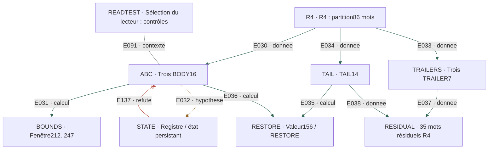

### Objets, opérations et limites

| ID / objet | Entrée | Opération | Sortie | Limite et provenance |
|---|---|---|---|---|
| **R4** — R4 : partition86 mots | G069 rune2 →G070 rune128 ;390 runes | 3×(CALL1+BODY16+TRAILER7)+TAIL14 | CALL aux rangs1,25,49 ;3 BODY ;3 trailers ;tail14 | Noms CALL/TRAILER fonctionnels proposés, non opcodes lus. Niveau : rapport. [R4-003](../recherches/07-r4-et-lecteur-spatial.md#r4-003) · [R4-004](../recherches/07-r4-et-lecteur-spatial.md#r4-004) |
| **ABC** — Trois BODY16 | 48 mots lexicaux, trois objets de16 | READ RIGHT/RIGHT pour chacun | 198,254,154 ; tags6,7,4 ; AND=130 | 272,195,288 avec l’unité physique : transfert uniforme contredit. Niveau : local. [R4-005](../recherches/07-r4-et-lecteur-spatial.md#r4-005) · [R4-006](../recherches/07-r4-et-lecteur-spatial.md#r4-006) · [R4-008](../recherches/07-r4-et-lecteur-spatial.md#r4-008) |
| **BOUNDS** — Fenêtre212..247 | 154,254 et198 | HADDR154=212 ; HADDR254=247 ; F0[246]=198 | Bornes BODY36 et sentinelle candidate | Les tags seuls perdent l’information qui fixe les bornes. Niveau : local. [F0-009](../recherches/06-f0-familles-d-et-routage.md#f0-009) · [R4-008](../recherches/07-r4-et-lecteur-spatial.md#r4-008) |
| **STATE** — Registre / état persistant | Tags proposés [3,6,7] puis [6,7,4] | Modèle de fenêtre glissante et ablation | BODY C reste154 sur512 états entrants rapportés | Causalité de l’état non établie ; les fonctions pures suffisent au replay. Niveau : rapport. [F0-016](../recherches/06-f0-familles-d-et-routage.md#f0-016) · [R4-012](../recherches/07-r4-et-lecteur-spatial.md#r4-012) · [A01](SOURCES.md) |
| **TRAILERS** — Trois TRAILER7 | Les7 mots après chaque BODY | Lecteur LRLRLRL | Sommes397,422,139 ; les deux premières routes vers D33 | La troisième ne ferme pas de la même manière. Niveau : rapport. [R4-010](../recherches/07-r4-et-lecteur-spatial.md#r4-010) |
| **TAIL** — TAIL14 | 14 derniers mots de R4 | Deux groupes de7 ; LRLRLRL ; mod256 et G | 331/321→75/65→156 en au plus2 G | 1/73 fenêtres rapporté ; règle de retour toujours candidate. Niveau : rapport. [R4-011](../recherches/07-r4-et-lecteur-spatial.md#r4-011) |
| **RESTORE** — Valeur156 / RESTORE | 198 ou les deux sorties du TAIL | G198=156=F0[10] | Convergence numérique vers156 | 156 n’identifie pas la prochaine cible :0 des29 préfixes du contrat. Niveau : local. [F0-013](../recherches/06-f0-familles-d-et-routage.md#f0-013) · [OUT-015](../recherches/09-seek-shift-et-objets-de-sortie.md#out-015) |
| **RESIDUAL** — 35 mots résiduels R4 | 3 trailers7 +tail14 | Comparer à35 sorties et35 mots G071 | Même cardinalité ; indexation directe négative | Trois ensembles de35 ne sont pas un seul objet. Niveau : rapport. [R4-013](../recherches/07-r4-et-lecteur-spatial.md#r4-013) |
| **READTEST** — Sélection du lecteur : contrôles | 29120 lecteurs d’extrémités ;3640 uniformes | Comparer les readouts A/B puis le BODY C déjà connu | A+B→2 lecteurs,uniformité→1 ;3035 paires dont2502 identifiantes | Choix rétrospectif ; unicité ≠rareté globale ; C154 non aveugle. Niveau : rapport. [R4-007](../recherches/07-r4-et-lecteur-spatial.md#r4-007) · [R4-009](../recherches/07-r4-et-lecteur-spatial.md#r4-009) |

### Liaisons internes

| ID | De → vers | Relation | Contrat / limite | Source |
|---|---|---|---|---|
| E030 | R4 ([C05](#c05)) → ABC ([C05](#c05)) | DONNEE | Extraire les trois BODY lexicaux | [R4-004](../recherches/07-r4-et-lecteur-spatial.md#r4-004) |
| E031 | ABC ([C05](#c05)) → BOUNDS ([C05](#c05)) | CALCUL | Utiliser les nombres complets, pas seulement high3 | [R4-008](../recherches/07-r4-et-lecteur-spatial.md#r4-008) |
| E032 | ABC ([C05](#c05)) → STATE ([C05](#c05)) | HYPOTHESE | Interpréter les tags comme mise à jour du registre | [F0-016](../recherches/06-f0-familles-d-et-routage.md#f0-016) |
| E033 | R4 ([C05](#c05)) → TRAILERS ([C05](#c05)) | DONNEE | Extraire3×7 mots | [R4-010](../recherches/07-r4-et-lecteur-spatial.md#r4-010) |
| E034 | R4 ([C05](#c05)) → TAIL ([C05](#c05)) | DONNEE | Extraire les14 mots finaux | [R4-011](../recherches/07-r4-et-lecteur-spatial.md#r4-011) |
| E035 | TAIL ([C05](#c05)) → RESTORE ([C05](#c05)) | CALCUL | Convergence numérique rapportée | [R4-011](../recherches/07-r4-et-lecteur-spatial.md#r4-011) |
| E036 | ABC ([C05](#c05)) → RESTORE ([C05](#c05)) | CALCUL | G198=156, sans sémantique RETURN établie | [F0-013](../recherches/06-f0-familles-d-et-routage.md#f0-013) |
| E037 | TRAILERS ([C05](#c05)) → RESIDUAL ([C05](#c05)) | DONNEE | 21 des35 mots résiduels | [R4-013](../recherches/07-r4-et-lecteur-spatial.md#r4-013) |
| E038 | TAIL ([C05](#c05)) → RESIDUAL ([C05](#c05)) | DONNEE | 14 des35 mots résiduels | [R4-013](../recherches/07-r4-et-lecteur-spatial.md#r4-013) |
| E091 | READTEST ([C05](#c05)) → ABC ([C05](#c05)) | CONTEXTE | Contrôles de sélection du lecteur ; pas commande de LP | [R4-007](../recherches/07-r4-et-lecteur-spatial.md#r4-007) · [R4-009](../recherches/07-r4-et-lecteur-spatial.md#r4-009) |
| E137 | STATE ([C05](#c05)) → ABC ([C05](#c05)) | REFUTE | L’ablation ne montre pas d’influence de512 états entrants sur BODY C | [R4-012](../recherches/07-r4-et-lecteur-spatial.md#r4-012) |

### Raccords avec les autres circuits

| ID | De → vers | Relation | Contrat / limite | Source |
|---|---|---|---|---|
| E104 | READ ([C01](#c01)) → ABC ([C05](#c05)) | HYPOTHESE | Appliquer le lecteur aux BODY lexicaux R4 | [R4-005](../recherches/07-r4-et-lecteur-spatial.md#r4-005) |
| E107 | BOUNDS ([C05](#c05)) → D30 ([C02](#c02)) | HYPOTHESE | Employer les bornes calculées pour ce cadre | [F0-009](../recherches/06-f0-familles-d-et-routage.md#f0-009) |
| E108 | BOUNDS ([C05](#c05)) → VEC35 ([C04](#c04)) | CALCUL | G sur la fenêtre fixée212..247 | [F0-010](../recherches/06-f0-familles-d-et-routage.md#f0-010) |
| E109 | TRAILERS ([C05](#c05)) → D33 ([C02](#c02)) | HYPOTHESE | Les deux premiers trailers rejoignent D33, pas le troisième | [R4-010](../recherches/07-r4-et-lecteur-spatial.md#r4-010) |
| E121 | FIVE ([C07](#c07)) → STATE ([C05](#c05)) | HYPOTHESE | Les cinq unités configureraient les comportements | [M6-008](../recherches/05-m6-liste-et-pre64.md#m6-008) |
| E131 | STATE ([C05](#c05)) → MEMORY ([C12](#c12)) | MANQUANT | Un effet causal de l’état reste à montrer | [R4-012](../recherches/07-r4-et-lecteur-spatial.md#r4-012) · [A01](SOURCES.md) |
| E135 | RESTORE ([C05](#c05)) → TARGET ([C10](#c10)) | REFUTE | Le contrat RESTORE156 ne sélectionne aucune des29 cibles | [OUT-015](../recherches/09-seek-shift-et-objets-de-sortie.md#out-015) |
| E136 | RESIDUAL ([C05](#c05)) → BODY35 ([C04](#c04)) | REFUTE | L’égalité de cardinalité ne valide pas l’indexation directe | [R4-013](../recherches/07-r4-et-lecteur-spatial.md#r4-013) |

## C06

**Raccords multi-supports** — Conserver les routes concurrentes sans imposer leur ordre.

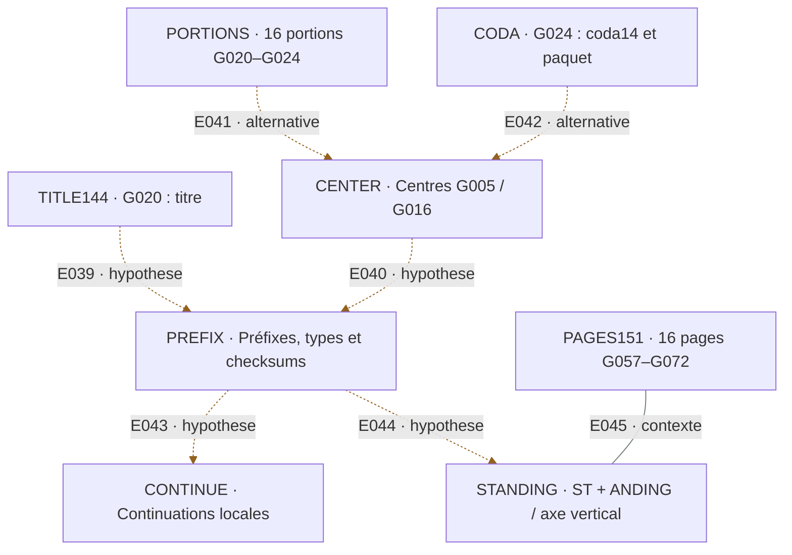

### Objets, opérations et limites

| ID / objet | Entrée | Opération | Sortie | Limite et provenance |
|---|---|---|---|---|
| **CENTER** — Centres G005 / G016 | FORM91 ; centre809 premier de rang140 | 91→φ72→F0[72]=164→G ; F0[140] | G005→80 ; G016→245 ; croix transformées rapportées | Choix de la transformation et fonction du résultat encore proposés. Niveau : rapport. [LNK-001](../recherches/08-raccords-multi-supports.md#lnk-001) · [LNK-002](../recherches/08-raccords-multi-supports.md#lnk-002) |
| **TITLE144** — G020 : titre | 16 runes du titre | G032 RIGHT/RIGHT | J,J,X,H ; somme144 | Candidat sélecteur pour G023, non adresse imposée. Niveau : rapport. [LNK-007](../recherches/08-raccords-multi-supports.md#lnk-007) |
| **PREFIX** — Préfixes, types et checksums | G023, G068, G059, G040 | Choisir un préfixe selon forme et checksum, puis READ | G023→284→φ140→245 ; G068→ANDING ; G059→140→φ48→253 ; G040→130 | Règles rétrospectives ; G040112 diverge ensuite selon F0 si on applique G. Niveau : rapport. [LNK-003](../recherches/08-raccords-multi-supports.md#lnk-003) · [LNK-004](../recherches/08-raccords-multi-supports.md#lnk-004) · [LNK-005](../recherches/08-raccords-multi-supports.md#lnk-005) · [LNK-006](../recherches/08-raccords-multi-supports.md#lnk-006) |
| **PORTIONS** — 16 portions G020–G024 | Portions bornées dans le rapport V5 | G032 RIGHT/RIGHT | D,T,EO,EO→230→G→80 | Bornes héritées de la source ; pas nouveau relevé indépendant. Niveau : rapport. [LNK-008](../recherches/08-raccords-multi-supports.md#lnk-008) |
| **PAGES151** — 16 pages G057–G072 | Groupes de bord selon le rapport, G067 sans runes | G032 RIGHT/RIGHT | D,J,F,H ; somme151 (36e premier) | 151 n’est pas GP15 ; ce raccord ne décode pas RETURN. Niveau : rapport. [LNK-009](../recherches/08-raccords-multi-supports.md#lnk-009) · [A01](SOURCES.md) |
| **CODA** — G024 : coda14 et paquet | Runes195..208 ; deux groupes de7 | LRLRLRL ; réduction mod256 | 445→189 ; dernière moitié409 ; paquet409/245/168→80 | 1/13123 fenêtres rapporté après exploration ; format universel réfuté par G026. Niveau : rapport. [LNK-010](../recherches/08-raccords-multi-supports.md#lnk-010) · [LNK-011](../recherches/08-raccords-multi-supports.md#lnk-011) · [OUT-014](../recherches/09-seek-shift-et-objets-de-sortie.md#out-014) |
| **CONTINUE** — Continuations locales | Groupes17..23 de G068/G043/G064 | LRLRLRL puis opérations documentées | 383→127→230→80 ;371→115→112 ;353→97→222→198→156 | Suite de112 :120/144 selon F0 ; pas de NEXT uniforme établi. Niveau : rapport. [LNK-012](../recherches/08-raccords-multi-supports.md#lnk-012) · [ERR-003](../recherches/10-contre-epreuves-et-corrections.md#err-003) |
| **STANDING** — ST + ANDING / axe vertical | ST dans BODY36 ; ANDING ; motifs G024/G073 | Assemblage verbal et interprétation de l’axe | STANDING ; continuation candidate vers G073 | COUNT/END non universel ; lecture symbolique, non instruction démontrée. Niveau : rapport. [LNK-013](../recherches/08-raccords-multi-supports.md#lnk-013) · [LNK-014](../recherches/08-raccords-multi-supports.md#lnk-014) |

### Liaisons internes

| ID | De → vers | Relation | Contrat / limite | Source |
|---|---|---|---|---|
| E039 | TITLE144 ([C06](#c06)) → PREFIX ([C06](#c06)) | HYPOTHESE | 144 sélectionnerait le préfixe G023 | [LNK-003](../recherches/08-raccords-multi-supports.md#lnk-003) · [LNK-007](../recherches/08-raccords-multi-supports.md#lnk-007) |
| E040 | CENTER ([C06](#c06)) → PREFIX ([C06](#c06)) | HYPOTHESE | 80/245 réemployés comme sélecteurs sur d’autres pages | [LNK-001](../recherches/08-raccords-multi-supports.md#lnk-001) · [LNK-002](../recherches/08-raccords-multi-supports.md#lnk-002) · [LNK-004](../recherches/08-raccords-multi-supports.md#lnk-004) · [LNK-006](../recherches/08-raccords-multi-supports.md#lnk-006) |
| E041 | PORTIONS ([C06](#c06)) → CENTER ([C06](#c06)) | ALTERNATIVE | Deux constructions différentes convergent vers80 | [LNK-001](../recherches/08-raccords-multi-supports.md#lnk-001) · [LNK-008](../recherches/08-raccords-multi-supports.md#lnk-008) |
| E042 | CODA ([C06](#c06)) → CENTER ([C06](#c06)) | ALTERNATIVE | Autre recette vers80 ; aucune priorité d’exécution | [LNK-010](../recherches/08-raccords-multi-supports.md#lnk-010) |
| E043 | PREFIX ([C06](#c06)) → CONTINUE ([C06](#c06)) | HYPOTHESE | Poursuivre après les16 groupes avec un lecteur de7 | [LNK-012](../recherches/08-raccords-multi-supports.md#lnk-012) |
| E044 | PREFIX ([C06](#c06)) → STANDING ([C06](#c06)) | HYPOTHESE | Interpréter ANDING comme élément de l’assemblage | [LNK-013](../recherches/08-raccords-multi-supports.md#lnk-013) |
| E045 | PAGES151 ([C06](#c06)) → STANDING ([C06](#c06)) | CONTEXTE | Raccords de navigation étudiés dans la même région | [LNK-009](../recherches/08-raccords-multi-supports.md#lnk-009) · [LNK-014](../recherches/08-raccords-multi-supports.md#lnk-014) |

### Raccords avec les autres circuits

| ID | De → vers | Relation | Contrat / limite | Source |
|---|---|---|---|---|
| E129 | PAGES151 ([C06](#c06)) → LOOP69 ([C08](#c08)) | HYPOTHESE | Rappel151 ; lecteur global distinct du lecteur local | [P01](../pieces/LP_CHAINE_CONTROLE_FINALE_20261021.md) · [LNK-009](../recherches/08-raccords-multi-supports.md#lnk-009) |

## C07

**M6, PRE64 et configuration graphique** — Ne pas réduire les cinq unités et les motifs à un rôle déjà acquis.

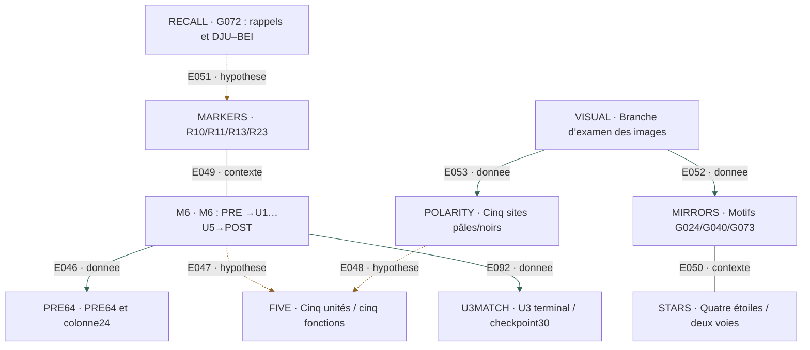

### Objets, opérations et limites

| ID / objet | Entrée | Opération | Sortie | Limite et provenance |
|---|---|---|---|---|
| **M6** — M6 : PRE →U1…U5→POST | G050–G056 ; liste G053–G055 | Partition et comptages | U1…U5 :139,91,98,96,129 runes ; total553 | U4 traverse G054/G055 ; PRE845/POST282 relève d’un découpage hérité. Niveau : rapport. [M6-001](../recherches/05-m6-liste-et-pre64.md#m6-001) · [M6-002](../recherches/05-m6-liste-et-pre64.md#m6-002) · [M6-006](../recherches/05-m6-liste-et-pre64.md#m6-006) |
| **PRE64** — PRE64 et colonne24 | 64 mots /292 runes avant le premier item | Grille8×8 ; première colonne8 mots de3 runes | 24 runes pour essais de clés / états | Essais clés LP1, César, totient et resets négatifs ; pas de BOOT identifié. Niveau : rapport. [M6-003](../recherches/05-m6-liste-et-pre64.md#m6-003) · [M6-004](../recherches/05-m6-liste-et-pre64.md#m6-004) |
| **FIVE** — Cinq unités / cinq fonctions | U1…U5 ; paires U1/U5 etU2/U4 | Comparer formes, longueurs et rôles possibles | Hypothèses : états, configuration, instructions, cinq fonctions de M7 | Ancien modèle de5 triplets non soutenu ; fonctions non identifiées. Niveau : rapport. [M6-005](../recherches/05-m6-liste-et-pre64.md#m6-005) · [M6-007](../recherches/05-m6-liste-et-pre64.md#m6-007) · [M6-008](../recherches/05-m6-liste-et-pre64.md#m6-008) |
| **POLARITY** — Cinq sites pâles/noirs | G057–G072 ; gauche255,0,0,255,0 ; droite noire | Coder la polarité | 01101=13 ; signes M6 proposés | U5 commence83, non66 ; la polarité n’est pas un décodeur établi. Niveau : rapport. [VIS-004](../recherches/04-images-dessins-et-marqueurs.md#vis-004) · [VIS-005](../recherches/04-images-dessins-et-marqueurs.md#vis-005) · [ERR-005](../recherches/10-contre-epreuves-et-corrections.md#err-005) |
| **MARKERS** — R10/R11/R13/R23 | 67 motifs,796 carrés inventoriés | 13 R10 ;23 R11 ;30 R13 ;1 R23 | R10 près de M6, F0 et G073, aussi près de runes | Association constatée ; pas opcode universel de changement de représentation. Niveau : rapport. [VIS-009](../recherches/04-images-dessins-et-marqueurs.md#vis-009) · [VIS-010](../recherches/04-images-dessins-et-marqueurs.md#vis-010) · [ERR-006](../recherches/10-contre-epreuves-et-corrections.md#err-006) |
| **MIRRORS** — Motifs G024/G040/G073 | Points et orientations des dessins | Réflexions verticale/horizontale ; demi-tour | Codes proposés5/26/20 ; G5=80 ;G26=57→φ36 ;G20=233 | Relations graphiques et codage numérique sont deux niveaux distincts. Niveau : rapport. [VIS-006](../recherches/04-images-dessins-et-marqueurs.md#vis-006) · [VIS-007](../recherches/04-images-dessins-et-marqueurs.md#vis-007) · [VIS-008](../recherches/04-images-dessins-et-marqueurs.md#vis-008) · [VIS-029](../recherches/04-images-dessins-et-marqueurs.md#vis-029) |
| **STARS** — Quatre étoiles / deux voies | G041–G043 ; quatre positions | Apparier [1,3] et[2,4] avec D34 | Voie A [172,180] ; voie B [230,36] | L’appariement fonctionnel est proposé ;230→80 est un calcul exact après ce choix. Niveau : rapport. [VIS-011](../recherches/04-images-dessins-et-marqueurs.md#vis-011) · [VIS-012](../recherches/04-images-dessins-et-marqueurs.md#vis-012) |
| **RECALL** — G072 : rappels et DJU–BEI | Arbre, insecte, cadre, répétition G044/G072 | Comparer les motifs et les groupes littéraux | Rappels vers G044/G049/G057/G070 ; écarts5/8/13 ; BEI45 | Répétition ≠ CALL/RETURN ; clés DJU–BEI négatives. Niveau : rapport. [VIS-003](../recherches/04-images-dessins-et-marqueurs.md#vis-003) · [VIS-013](../recherches/04-images-dessins-et-marqueurs.md#vis-013) · [VIS-014](../recherches/04-images-dessins-et-marqueurs.md#vis-014) · [VIS-015](../recherches/04-images-dessins-et-marqueurs.md#vis-015) · [VIS-016](../recherches/04-images-dessins-et-marqueurs.md#vis-016) |
| **VISUAL** — Branche d’examen des images | 75 images, croix, disques, couronnes, gris et résidus JPEG | Seuils, contrôles JPEG, agrandissements, superpositions | Observations et témoins consignés dans29 fiches visuelles | Aucun nouveau texte authentifié par cette seule branche ; rôle VM non établi. Niveau : rapport. [VIS-001](../recherches/04-images-dessins-et-marqueurs.md#vis-001) · [VIS-002](../recherches/04-images-dessins-et-marqueurs.md#vis-002) · [VIS-017](../recherches/04-images-dessins-et-marqueurs.md#vis-017) · [VIS-018](../recherches/04-images-dessins-et-marqueurs.md#vis-018) · [VIS-019](../recherches/04-images-dessins-et-marqueurs.md#vis-019) · [VIS-020](../recherches/04-images-dessins-et-marqueurs.md#vis-020) · [VIS-021](../recherches/04-images-dessins-et-marqueurs.md#vis-021) · [VIS-022](../recherches/04-images-dessins-et-marqueurs.md#vis-022) · [VIS-023](../recherches/04-images-dessins-et-marqueurs.md#vis-023) · [VIS-024](../recherches/04-images-dessins-et-marqueurs.md#vis-024) · [VIS-025](../recherches/04-images-dessins-et-marqueurs.md#vis-025) · [VIS-026](../recherches/04-images-dessins-et-marqueurs.md#vis-026) · [VIS-027](../recherches/04-images-dessins-et-marqueurs.md#vis-027) · [VIS-028](../recherches/04-images-dessins-et-marqueurs.md#vis-028) |
| **U3MATCH** — U3 terminal / checkpoint30 | Fin U3 et segment terminal G068 | Comparer30 runes,6 mots lexicaux,7 groupes physiques | Compatibilité de taille rapportée | Ni l’opération ni le sens de transfert ne sont sélectionnés par cette égalité. Niveau : rapport. [M6-009](../recherches/05-m6-liste-et-pre64.md#m6-009) |

### Liaisons internes

| ID | De → vers | Relation | Contrat / limite | Source |
|---|---|---|---|---|
| E046 | M6 ([C07](#c07)) → PRE64 ([C07](#c07)) | DONNEE | Sous-objet avant le premier item de la liste | [M6-003](../recherches/05-m6-liste-et-pre64.md#m6-003) |
| E047 | M6 ([C07](#c07)) → FIVE ([C07](#c07)) | HYPOTHESE | Interpréter les cinq unités comme fonctions | [M6-008](../recherches/05-m6-liste-et-pre64.md#m6-008) |
| E048 | POLARITY ([C07](#c07)) → FIVE ([C07](#c07)) | HYPOTHESE | Appliquer les cinq signes aux cinq unités | [VIS-005](../recherches/04-images-dessins-et-marqueurs.md#vis-005) |
| E049 | MARKERS ([C07](#c07)) → M6 ([C07](#c07)) | CONTEXTE | Présence de R10, sans fonction causale établie | [VIS-010](../recherches/04-images-dessins-et-marqueurs.md#vis-010) |
| E050 | MIRRORS ([C07](#c07)) → STARS ([C07](#c07)) | CONTEXTE | Deux branches graphiques ; aucune transition d’exécution proposée ici | [VIS-007](../recherches/04-images-dessins-et-marqueurs.md#vis-007) · [VIS-012](../recherches/04-images-dessins-et-marqueurs.md#vis-012) |
| E051 | RECALL ([C07](#c07)) → MARKERS ([C07](#c07)) | HYPOTHESE | Lire certains motifs de G072 comme rappels | [VIS-016](../recherches/04-images-dessins-et-marqueurs.md#vis-016) |
| E052 | VISUAL ([C07](#c07)) → MIRRORS ([C07](#c07)) | DONNEE | Relevés d’orientation contrôlés sur les images | [VIS-006](../recherches/04-images-dessins-et-marqueurs.md#vis-006) · [VIS-007](../recherches/04-images-dessins-et-marqueurs.md#vis-007) |
| E053 | VISUAL ([C07](#c07)) → POLARITY ([C07](#c07)) | DONNEE | Relevés de contraste des cinq sites | [VIS-004](../recherches/04-images-dessins-et-marqueurs.md#vis-004) |
| E092 | M6 ([C07](#c07)) → U3MATCH ([C07](#c07)) | DONNEE | Extraire le segment terminal de U3 | [M6-009](../recherches/05-m6-liste-et-pre64.md#m6-009) |

### Raccords avec les autres circuits

| ID | De → vers | Relation | Contrat / limite | Source |
|---|---|---|---|---|
| E093 | U3MATCH ([C07](#c07)) → ANDING ([C04](#c04)) | HYPOTHESE | Raccorder au checkpoint, distinct du préfixe ANDING | [M6-009](../recherches/05-m6-liste-et-pre64.md#m6-009) |
| E120 | PRE64 ([C07](#c07)) → BOOT ([C12](#c12)) | HYPOTHESE | Candidat d’initialisation, essais négatifs conservés | [M6-004](../recherches/05-m6-liste-et-pre64.md#m6-004) · [A01](SOURCES.md) |
| E121 | FIVE ([C07](#c07)) → STATE ([C05](#c05)) | HYPOTHESE | Les cinq unités configureraient les comportements | [M6-008](../recherches/05-m6-liste-et-pre64.md#m6-008) |
| E122 | M6 ([C07](#c07)) → ANDING ([C04](#c04)) | HYPOTHESE | Terminal U3 de30 runes / checkpoint30 : compatibilité, pas opération | [M6-009](../recherches/05-m6-liste-et-pre64.md#m6-009) |
| E123 | STARS ([C07](#c07)) → D34 ([C02](#c02)) | HYPOTHESE | Deux voies graphiques associées aux quatre octets | [VIS-012](../recherches/04-images-dessins-et-marqueurs.md#vis-012) |
| E124 | MIRRORS ([C07](#c07)) → EXIT73 ([C08](#c08)) | HYPOTHESE | Réflexion G024→G073 comme continuation | [LNK-014](../recherches/08-raccords-multi-supports.md#lnk-014) |
| E125 | RECALL ([C07](#c07)) → LOOP72 ([C08](#c08)) | HYPOTHESE | Motifs utilisés comme dispatch dans P01 | [P01](../pieces/LP_CHAINE_CONTROLE_FINALE_20261021.md) |

## C08

**Boucle de contrôle proposée** — Conserver le scénario P01 en rendant explicite chaque transition non démontrée.

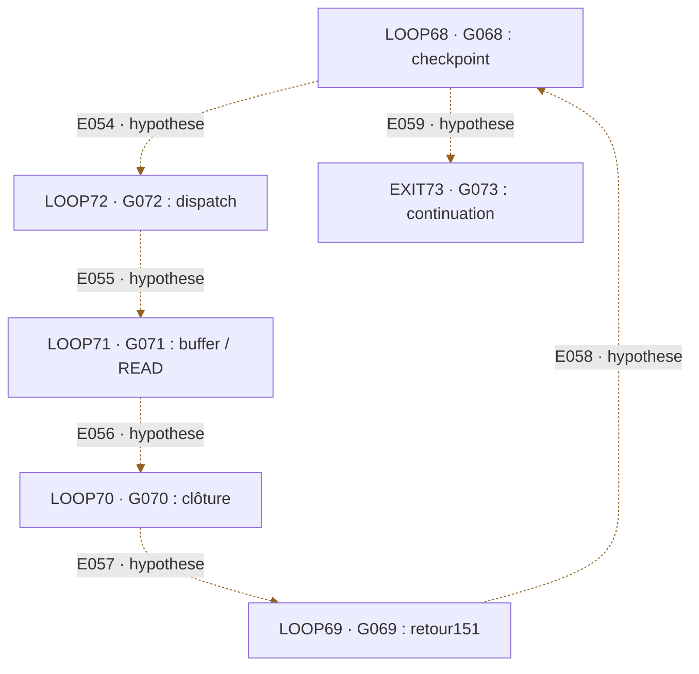

### Objets, opérations et limites

| ID / objet | Entrée | Opération | Sortie | Limite et provenance |
|---|---|---|---|---|
| **LOOP68** — G068 : checkpoint | Préfixe, ANDING, segment30 | Initialisation / checkpoint proposés | Choix de dispatch G072 | Le calcul local n’établit ni PC autonome, ni CALL/RETURN, ni condition de sortie. Niveau : rapport. [P01](../pieces/LP_CHAINE_CONTROLE_FINALE_20261021.md) · [LNK-004](../recherches/08-raccords-multi-supports.md#lnk-004) |
| **LOOP72** — G072 : dispatch | Rappels graphiques et bloc64 | Dispatch proposé | Choix du buffer G071 | Le calcul local n’établit ni PC autonome, ni CALL/RETURN, ni condition de sortie. Niveau : rapport. [P01](../pieces/LP_CHAINE_CONTROLE_FINALE_20261021.md) · [VIS-016](../recherches/04-images-dessins-et-marqueurs.md#vis-016) |
| **LOOP71** — G071 : buffer / READ | BODY35 et masque16 | SELECT / READ proposés | 132 ; choix de la clôture G070 | Le calcul local n’établit ni PC autonome, ni CALL/RETURN, ni condition de sortie. Niveau : rapport. [P01](../pieces/LP_CHAINE_CONTROLE_FINALE_20261021.md) · [P02](../pieces/LP_READ_CHECKPOINT_20261021.md) |
| **LOOP70** — G070 : clôture | Bloc noir et coda rouge | Clôture / contrôle proposés | 150/144 ; choix du retour G069 | Le calcul local n’établit ni PC autonome, ni CALL/RETURN, ni condition de sortie. Niveau : rapport. [P01](../pieces/LP_CHAINE_CONTROLE_FINALE_20261021.md) · [R4-015](../recherches/07-r4-et-lecteur-spatial.md#r4-015) |
| **LOOP69** — G069 : retour151 | Readout local et rappel151 | RETURN proposé | Retour au checkpoint G068 | Le calcul local n’établit ni PC autonome, ni CALL/RETURN, ni condition de sortie. Niveau : rapport. [P01](../pieces/LP_CHAINE_CONTROLE_FINALE_20261021.md) |
| **EXIT73** — G073 : continuation | Fin du scénario et page résolue | Sortie du cycle proposée | Recherche de la page à empreinte512bits | Le calcul local n’établit ni PC autonome, ni CALL/RETURN, ni condition de sortie. Niveau : rapport. [P01](../pieces/LP_CHAINE_CONTROLE_FINALE_20261021.md) · [OUT-001](../recherches/09-seek-shift-et-objets-de-sortie.md#out-001) |

### Liaisons internes

| ID | De → vers | Relation | Contrat / limite | Source |
|---|---|---|---|---|
| E054 | LOOP68 ([C08](#c08)) → LOOP72 ([C08](#c08)) | HYPOTHESE | Transition du scénario P01 ; décision NEXT non reconstruite | [P01](../pieces/LP_CHAINE_CONTROLE_FINALE_20261021.md) · [A01](SOURCES.md) |
| E055 | LOOP72 ([C08](#c08)) → LOOP71 ([C08](#c08)) | HYPOTHESE | Transition du scénario P01 ; décision NEXT non reconstruite | [P01](../pieces/LP_CHAINE_CONTROLE_FINALE_20261021.md) · [A01](SOURCES.md) |
| E056 | LOOP71 ([C08](#c08)) → LOOP70 ([C08](#c08)) | HYPOTHESE | Transition du scénario P01 ; décision NEXT non reconstruite | [P01](../pieces/LP_CHAINE_CONTROLE_FINALE_20261021.md) · [A01](SOURCES.md) |
| E057 | LOOP70 ([C08](#c08)) → LOOP69 ([C08](#c08)) | HYPOTHESE | Transition du scénario P01 ; décision NEXT non reconstruite | [P01](../pieces/LP_CHAINE_CONTROLE_FINALE_20261021.md) · [A01](SOURCES.md) |
| E058 | LOOP69 ([C08](#c08)) → LOOP68 ([C08](#c08)) | HYPOTHESE | Transition du scénario P01 ; décision NEXT non reconstruite | [P01](../pieces/LP_CHAINE_CONTROLE_FINALE_20261021.md) · [A01](SOURCES.md) |
| E059 | LOOP68 ([C08](#c08)) → EXIT73 ([C08](#c08)) | HYPOTHESE | Transition du scénario P01 ; décision NEXT non reconstruite | [P01](../pieces/LP_CHAINE_CONTROLE_FINALE_20261021.md) · [A01](SOURCES.md) |

### Raccords avec les autres circuits

| ID | De → vers | Relation | Contrat / limite | Source |
|---|---|---|---|---|
| E124 | MIRRORS ([C07](#c07)) → EXIT73 ([C08](#c08)) | HYPOTHESE | Réflexion G024→G073 comme continuation | [LNK-014](../recherches/08-raccords-multi-supports.md#lnk-014) |
| E125 | RECALL ([C07](#c07)) → LOOP72 ([C08](#c08)) | HYPOTHESE | Motifs utilisés comme dispatch dans P01 | [P01](../pieces/LP_CHAINE_CONTROLE_FINALE_20261021.md) |
| E126 | ANDING ([C04](#c04)) → LOOP68 ([C08](#c08)) | HYPOTHESE | Sémantique de checkpoint proposée | [P01](../pieces/LP_CHAINE_CONTROLE_FINALE_20261021.md) |
| E127 | READ132 ([C04](#c04)) → LOOP71 ([C08](#c08)) | HYPOTHESE | Sémantique de buffer / READ proposée | [P01](../pieces/LP_CHAINE_CONTROLE_FINALE_20261021.md) · [P02](../pieces/LP_READ_CHECKPOINT_20261021.md) |
| E128 | CLOSE144 ([C04](#c04)) → LOOP70 ([C08](#c08)) | HYPOTHESE | Sémantique de clôture proposée | [P01](../pieces/LP_CHAINE_CONTROLE_FINALE_20261021.md) |
| E129 | PAGES151 ([C06](#c06)) → LOOP69 ([C08](#c08)) | HYPOTHESE | Rappel151 ; lecteur global distinct du lecteur local | [P01](../pieces/LP_CHAINE_CONTROLE_FINALE_20261021.md) · [LNK-009](../recherches/08-raccords-multi-supports.md#lnk-009) |
| E130 | EXIT73 ([C08](#c08)) → HASH73 ([C11](#c11)) | DONNEE | Page résolue et instruction de recherche extérieure | [OUT-001](../recherches/09-seek-shift-et-objets-de-sortie.md#out-001) |

## C09

**SPECIAL →deux candidats** — Deux gestes concurrents et une compression inversible.

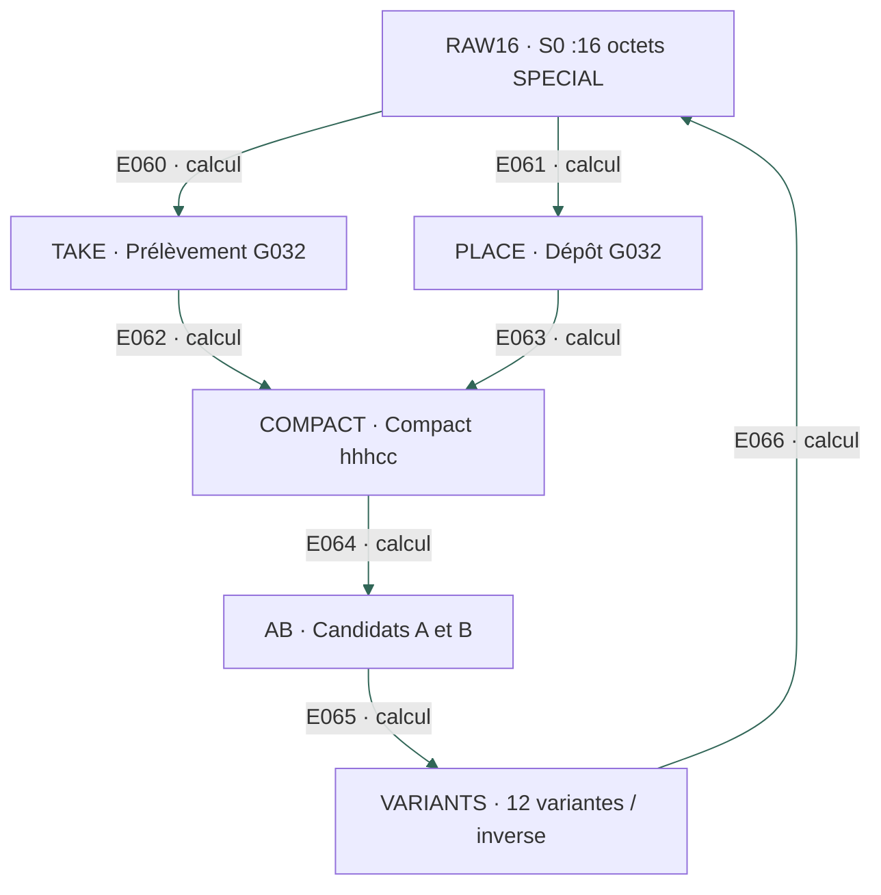

### Objets, opérations et limites

| ID / objet | Entrée | Opération | Sortie | Limite et provenance |
|---|---|---|---|---|
| **RAW16** — S0 :16 octets SPECIAL | Les16 SPECIAL en ordre physique | Concaténation | 7edefdfeffde3f1f7dbdfe9f7f3d9ebd | 128 bits de stockage,48 bits constants : pas128 bits indépendants. Niveau : local. [OUT-009](../recherches/09-seek-shift-et-objets-de-sortie.md#out-009) · [A03](SOURCES.md) |
| **TAKE** — Prélèvement G032 | S0 et permutation P | out[k]=S0[P[k]-1] | 16 octets réordonnés selon le lecteur historique | Choisir ce geste pour l’export est une hypothèse. Niveau : local. [OUT-009](../recherches/09-seek-shift-et-objets-de-sortie.md#out-009) · [A03](SOURCES.md) |
| **PLACE** — Dépôt G032 | S0 et permutation P | grid[P[k]-1]=S0[k] ; lire par lignes | 16 octets disposés ; précédent du T de classe30 | Même statut candidat que le prélèvement. Niveau : local. [A03](SOURCES.md) · [A01](SOURCES.md) |
| **COMPACT** — Compact hhhcc | SPECIAL de forme hhh111cc | Retirer les3 bits constants ; encoder Base32 | 5 bits par symbole ;16 caractères =80 bits | Transformation réversible avec l’ordre connu, non extraction d’un secret. Niveau : local. [OUT-009](../recherches/09-seek-shift-et-objets-de-sortie.md#out-009) · [A03](SOURCES.md) |
| **AB** — Candidats A et B | Compact du prélèvement ou du dépôt | Encodage Base32 | A=2h6vn7o256dtvsfp ; B=hdnv2o26765tvsfp | Forme Tor v2 compatible ; existence historique et lien Cicada non authentifiés. Niveau : local. [A03](SOURCES.md) · [A05](SOURCES.md) |
| **VARIANTS** — 12 variantes / inverse | 6 ordres ×2 sérialisations des bits | Comparer les exports ; inverser n→((n>>2)<<5) / 28 / (n&3) | S0 reconstituable à partir du compact et de l’ordre | La compatibilité de format ne sélectionne pas une variante. Niveau : local. [OUT-010](../recherches/09-seek-shift-et-objets-de-sortie.md#out-010) · [A03](SOURCES.md) |

### Liaisons internes

| ID | De → vers | Relation | Contrat / limite | Source |
|---|---|---|---|---|
| E060 | RAW16 ([C09](#c09)) → TAKE ([C09](#c09)) | CALCUL | Permutation par prélèvement | [A01](SOURCES.md) |
| E061 | RAW16 ([C09](#c09)) → PLACE ([C09](#c09)) | CALCUL | Permutation par dépôt | [A01](SOURCES.md) |
| E062 | TAKE ([C09](#c09)) → COMPACT ([C09](#c09)) | CALCUL | Compacter la sortie A | [A01](SOURCES.md) |
| E063 | PLACE ([C09](#c09)) → COMPACT ([C09](#c09)) | CALCUL | Compacter la sortie B | [A01](SOURCES.md) |
| E064 | COMPACT ([C09](#c09)) → AB ([C09](#c09)) | CALCUL | Alphabet Base32 déclaré | [A01](SOURCES.md) |
| E065 | AB ([C09](#c09)) → VARIANTS ([C09](#c09)) | CALCUL | Inverse exact et ordres concurrents | [A01](SOURCES.md) · [A03](SOURCES.md) |
| E066 | VARIANTS ([C09](#c09)) → RAW16 ([C09](#c09)) | CALCUL | Retour aux octets source avec l’ordre connu | [A01](SOURCES.md) |

### Raccords avec les autres circuits

| ID | De → vers | Relation | Contrat / limite | Source |
|---|---|---|---|---|
| E110 | SPECIAL ([C02](#c02)) → RAW16 ([C09](#c09)) | CALCUL | Lire les16 valeurs dans l’ordre physique | [A01](SOURCES.md) |
| E111 | P16 ([C01](#c01)) → TAKE ([C09](#c09)) | DONNEE | Même permutation P | [A01](SOURCES.md) |
| E112 | P16 ([C01](#c01)) → PLACE ([C09](#c09)) | DONNEE | Même permutation P, geste inverse | [A01](SOURCES.md) |
| E113 | AB ([C09](#c09)) → IDENTITY ([C11](#c11)) | HYPOTHESE | Interpréter les80bits comme identifiants de services Tor historiques | [A05](SOURCES.md) |
| E114 | RAW16 ([C09](#c09)) → AUTH ([C11](#c11)) | REFUTE | Même SPECIAL brut ≠secret indépendant du compact et de son ordre | [A03](SOURCES.md) |

## C10

**SEEK / SHIFT et branche G054** — La seconde voie d’export et ses échecs de généralisation.

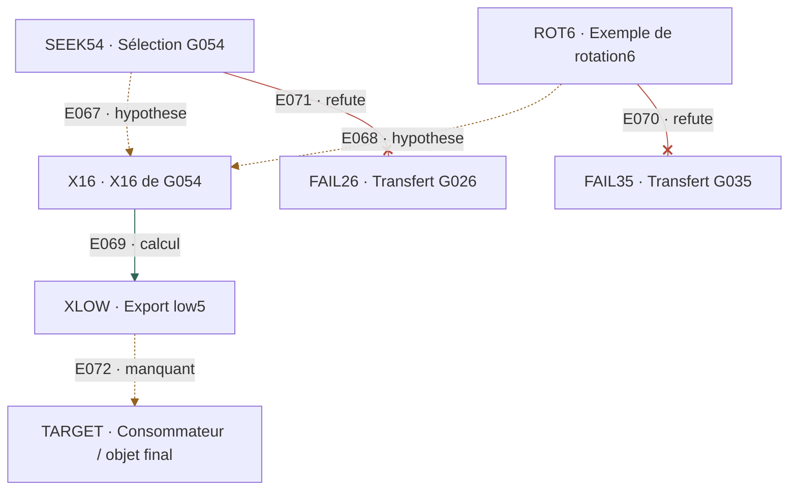

### Objets, opérations et limites

| ID / objet | Entrée | Opération | Sortie | Limite et provenance |
|---|---|---|---|---|
| **SEEK54** — Sélection G054 | Couple proposé112/147 | Préfixe3 lignes achevées,16 groupes ; checksum3475 mod256 | G054 ; READ A,I,S,W=200 ;footer936→168 | WEB=147 a aussi la collision ROUTE ; sélection non unique par le seul mot. Niveau : rapport. [OUT-002](../recherches/09-seek-shift-et-objets-de-sortie.md#out-002) · [OUT-003](../recherches/09-seek-shift-et-objets-de-sortie.md#out-003) · [ERR-007](../recherches/10-contre-epreuves-et-corrections.md#err-007) · [ERR-008](../recherches/10-contre-epreuves-et-corrections.md#err-008) |
| **ROT6** — Exemple de rotation6 | Colonnes G049 :159,282,276,168 | 282−276=6 ;ROR8(159,6) | 126, un SPECIAL | L’exemple ne commande pas uniformément la rotation des autres objets. Niveau : rapport. [OUT-004](../recherches/09-seek-shift-et-objets-de-sortie.md#out-004) |
| **X16** — X16 de G054 | 16 premiers groupes sur22 du bloc U2 | GP mod256 →G032 →ROR8(6) | 0309263b6b02dbb9910846e8bc6516f8 | Préfixe, CAST8, permutation et rotation doivent tous être justifiés. Niveau : rapport. [OUT-005](../recherches/09-seek-shift-et-objets-de-sortie.md#out-005) |
| **XLOW** — Export low5 | 16 octets X16 | low5 puis Base32 | djg3lc3zrigi4fwy ;48 bits écartés009635817ac7 | Branche historique conditionnelle ; aucune identité extérieure authentifiée. Niveau : rapport. [OUT-006](../recherches/09-seek-shift-et-objets-de-sortie.md#out-006) · [OUT-007](../recherches/09-seek-shift-et-objets-de-sortie.md#out-007) · [OUT-008](../recherches/09-seek-shift-et-objets-de-sortie.md#out-008) |
| **FAIL35** — Transfert G035 | Colonnes154,98,210,168 | Différence mod8=0 ;ROR8(154,0) | 154 ordinaire | Échec de ce transfert uniforme de l’exemple G049. Niveau : rapport. [OUT-013](../recherches/09-seek-shift-et-objets-de-sortie.md#out-013) |
| **FAIL26** — Transfert G026 | Format de paquet proposé409/245/168 | Prédiction de checksum sur une autre page | 150 prédit ;248 observé ;extension0/15 | Réfutation du format généralisé, pas effacement des calculs locaux. Niveau : rapport. [OUT-014](../recherches/09-seek-shift-et-objets-de-sortie.md#out-014) |
| **TARGET** — Consommateur / objet final | 80,132, X16 ou sorties candidates | Chercher une opération et une cible imposées indépendamment | Aucun nouveau plaintext LP2 ni objet dormant reconnu | APPLY / EMIT / HALT non reconstruits. Niveau : rapport. [OUT-015](../recherches/09-seek-shift-et-objets-de-sortie.md#out-015) · [OUT-016](../recherches/09-seek-shift-et-objets-de-sortie.md#out-016) · [A01](SOURCES.md) |

### Liaisons internes

| ID | De → vers | Relation | Contrat / limite | Source |
|---|---|---|---|---|
| E067 | SEEK54 ([C10](#c10)) → X16 ([C10](#c10)) | HYPOTHESE | Choisir les16 premiers groupes du bloc retenu | [OUT-005](../recherches/09-seek-shift-et-objets-de-sortie.md#out-005) |
| E068 | ROT6 ([C10](#c10)) → X16 ([C10](#c10)) | HYPOTHESE | Transférer la rotation6 de l’exemple G049 | [OUT-004](../recherches/09-seek-shift-et-objets-de-sortie.md#out-004) · [OUT-005](../recherches/09-seek-shift-et-objets-de-sortie.md#out-005) |
| E069 | X16 ([C10](#c10)) → XLOW ([C10](#c10)) | CALCUL | low5 et Base32 sous la recette déclarée | [OUT-006](../recherches/09-seek-shift-et-objets-de-sortie.md#out-006) |
| E070 | ROT6 ([C10](#c10)) → FAIL35 ([C10](#c10)) | REFUTE | Même règle transférée à G035 ne donne pas SPECIAL | [OUT-013](../recherches/09-seek-shift-et-objets-de-sortie.md#out-013) |
| E071 | SEEK54 ([C10](#c10)) → FAIL26 ([C10](#c10)) | REFUTE | Généralisation du paquet contredite par G026 | [OUT-014](../recherches/09-seek-shift-et-objets-de-sortie.md#out-014) |
| E072 | XLOW ([C10](#c10)) → TARGET ([C10](#c10)) | MANQUANT | Identifier le destinataire et son usage | [OUT-016](../recherches/09-seek-shift-et-objets-de-sortie.md#out-016) |

### Raccords avec les autres circuits

| ID | De → vers | Relation | Contrat / limite | Source |
|---|---|---|---|---|
| E115 | X16 ([C10](#c10)) → AUTH ([C11](#c11)) | HYPOTHESE | Tester un rôle de cookie ne suffit pas à le démontrer | [A03](SOURCES.md) · [A04](SOURCES.md) · [A05](SOURCES.md) |
| E116 | XLOW ([C10](#c10)) → IDENTITY ([C11](#c11)) | ALTERNATIVE | Troisième export historique conditionnel, hors paire A/B | [OUT-006](../recherches/09-seek-shift-et-objets-de-sortie.md#out-006) |
| E117 | BLOCK64 ([C04](#c04)) → TARGET ([C10](#c10)) | MANQUANT | Identifier le consommateur de80 | [A01](SOURCES.md) |
| E118 | READ132 ([C04](#c04)) → TARGET ([C10](#c10)) | MANQUANT | Identifier un consommateur imposé de132 | [A01](SOURCES.md) |
| E119 | G230 ([C03](#c03)) → TARGET ([C10](#c10)) | MANQUANT | 80 reste une valeur sans destinataire commandé | [A01](SOURCES.md) |
| E135 | RESTORE ([C05](#c05)) → TARGET ([C10](#c10)) | REFUTE | Le contrat RESTORE156 ne sélectionne aucune des29 cibles | [OUT-015](../recherches/09-seek-shift-et-objets-de-sortie.md#out-015) |
| E138 | TARGET ([C10](#c10)) → PROOF ([C11](#c11)) | MANQUANT | Objet final vérifiable indépendamment | [OUT-016](../recherches/09-seek-shift-et-objets-de-sortie.md#out-016) |

## C11

**Identité, autorisation et preuve extérieure** — Séparer les tailles compatibles des fonctions d’accès démontrées.

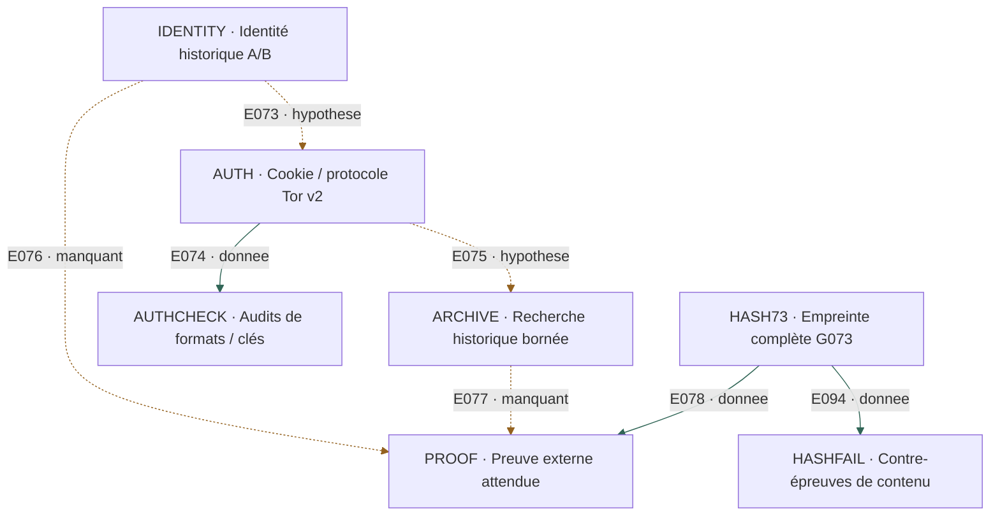

### Objets, opérations et limites

| ID / objet | Entrée | Opération | Sortie | Limite et provenance |
|---|---|---|---|---|
| **HASH73** — Empreinte complète G073 | Texte déchiffré selon la solution communautaire | Conserver les64 octets et la sérialisation du contenu | Empreinte512bits de la page recherchée | Le texte invite au deep web ; il ne nomme pas explicitement Tor. Niveau : rapport. [LP1-007](../recherches/02-apprentissage-et-precedents.md#lp1-007) · [OUT-001](../recherches/09-seek-shift-et-objets-de-sortie.md#out-001) |
| **IDENTITY** — Identité historique A/B | Identifiants80bits candidats | Chercher clé publique / descripteur et provenance indépendante | Aucune identité historique authentifiée | Une forme de16 caractères ou une mention n’équivaut pas à une clé vérifiée. Niveau : rapport. [OUT-012](../recherches/09-seek-shift-et-objets-de-sortie.md#out-012) · [A05](SOURCES.md) |
| **AUTH** — Cookie / protocole Tor v2 | Objet128bits éventuel ;hostname ;paramètres historiques | Hypothèses BASIC/STEALTH ; distinguer les mécanismes Tor Project | Rôle d’accès LP non identifié ; FORMAT MATCH ONLY | Spécification Tor créditée ; rien n’établit l’emploi de l’autorisation par Cicada. Niveau : rapport. [A03](SOURCES.md) · [A04](SOURCES.md) · [A05](SOURCES.md) · [TOR](https://torproject.gitlab.io/torspec/rend-spec-v2.html) |
| **AUTHCHECK** — Audits de formats / clés | A03 :17 suites ; A04 :319 témoins ; A05 :309 témoins | Encodages / allers-retours ; recherche de clés dans le périmètre | 34 /638 /618 encodages ; A05 :145 objets,0 parse de clé | Campagnes distinctes ; ne pas les additionner comme essais indépendants. Niveau : rapport. [A03](SOURCES.md) · [A04](SOURCES.md) · [A05](SOURCES.md) |
| **ARCHIVE** — Recherche historique bornée | Hostname, hypothèses de cookie, dates et fixtures | Calcul d’IDs et comparaison aux journaux existants | 13040 IDs distincts ;61 jeux de données ;0 correspondance | Pas de nouveau scan ici ;absence bornée ;identité, secret et existence non prouvés. Niveau : rapport. [A05](SOURCES.md) |
| **PROOF** — Preuve externe attendue | Pièce historique indépendante, clé/descripteur ou contenu | Recalculer identité/signature ;établir lien Cicada ;vérifier contenu G073 | Chaîne probante possible, encore absente | Ces contrôles sont des étapes à satisfaire, pas des résultats obtenus. Niveau : rapport. [OUT-012](../recherches/09-seek-shift-et-objets-de-sortie.md#out-012) · [A05](SOURCES.md) |
| **HASHFAIL** — Contre-épreuves de contenu | 33 sérialisations de X et335 contenus ZIP distincts | SHA-512 et comparaison à G073 dans le périmètre du rapport | Zéro concordance | Hacher une adresse ≠hacher sa page ; sérialisations alternatives et3 charges LFS absentes hors périmètre. Niveau : rapport. [OUT-011](../recherches/09-seek-shift-et-objets-de-sortie.md#out-011) |

### Liaisons internes

| ID | De → vers | Relation | Contrat / limite | Source |
|---|---|---|---|---|
| E073 | IDENTITY ([C11](#c11)) → AUTH ([C11](#c11)) | HYPOTHESE | Supposer qu’un de ces services aurait exigé une autorisation | [A04](SOURCES.md) · [A05](SOURCES.md) |
| E074 | AUTH ([C11](#c11)) → AUTHCHECK ([C11](#c11)) | DONNEE | Objets et hypothèses soumis aux contrôles de format | [A03](SOURCES.md) · [A04](SOURCES.md) · [A05](SOURCES.md) |
| E075 | AUTH ([C11](#c11)) → ARCHIVE ([C11](#c11)) | HYPOTHESE | Paramètres conditionnels pour calculer les IDs historiques | [A05](SOURCES.md) |
| E076 | IDENTITY ([C11](#c11)) → PROOF ([C11](#c11)) | MANQUANT | Obtenir une clé ou un descripteur de provenance indépendante | [OUT-012](../recherches/09-seek-shift-et-objets-de-sortie.md#out-012) |
| E077 | ARCHIVE ([C11](#c11)) → PROOF ([C11](#c11)) | MANQUANT | Aucune correspondance dans le périmètre consulté | [A05](SOURCES.md) |
| E078 | HASH73 ([C11](#c11)) → PROOF ([C11](#c11)) | DONNEE | Critère final sur le contenu, distinct de l’identité Tor | [OUT-001](../recherches/09-seek-shift-et-objets-de-sortie.md#out-001) |
| E094 | HASH73 ([C11](#c11)) → HASHFAIL ([C11](#c11)) | DONNEE | Empreinte de comparaison | [OUT-011](../recherches/09-seek-shift-et-objets-de-sortie.md#out-011) |

### Raccords avec les autres circuits

| ID | De → vers | Relation | Contrat / limite | Source |
|---|---|---|---|---|
| E113 | AB ([C09](#c09)) → IDENTITY ([C11](#c11)) | HYPOTHESE | Interpréter les80bits comme identifiants de services Tor historiques | [A05](SOURCES.md) |
| E114 | RAW16 ([C09](#c09)) → AUTH ([C11](#c11)) | REFUTE | Même SPECIAL brut ≠secret indépendant du compact et de son ordre | [A03](SOURCES.md) |
| E115 | X16 ([C10](#c10)) → AUTH ([C11](#c11)) | HYPOTHESE | Tester un rôle de cookie ne suffit pas à le démontrer | [A03](SOURCES.md) · [A04](SOURCES.md) · [A05](SOURCES.md) |
| E116 | XLOW ([C10](#c10)) → IDENTITY ([C11](#c11)) | ALTERNATIVE | Troisième export historique conditionnel, hors paire A/B | [OUT-006](../recherches/09-seek-shift-et-objets-de-sortie.md#out-006) |
| E130 | EXIT73 ([C08](#c08)) → HASH73 ([C11](#c11)) | DONNEE | Page résolue et instruction de recherche extérieure | [OUT-001](../recherches/09-seek-shift-et-objets-de-sortie.md#out-001) |
| E138 | TARGET ([C10](#c10)) → PROOF ([C11](#c11)) | MANQUANT | Objet final vérifiable indépendamment | [OUT-016](../recherches/09-seek-shift-et-objets-de-sortie.md#out-016) |

## C12

**Branches de recherche et verrous VM** — Rattacher aussi les campagnes négatives et les fonctions absentes.

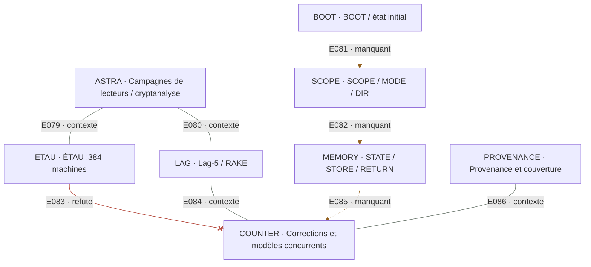

### Objets, opérations et limites

| ID / objet | Entrée | Opération | Sortie | Limite et provenance |
|---|---|---|---|---|
| **ASTRA** — Campagnes de lecteurs / cryptanalyse | HEAD24, B2, CP3/4/5, resets, blocs et lecteurs | Contrôles positifs ; réparation d’alignement ; mesures et modèles | Résultats et limites des21 fiches ASTRA | Rapports historiques ; la carte ne relance pas toutes ces campagnes. Niveau : rapport. [AST-001](../recherches/03-astra-et-cryptanalyse.md#ast-001) · [AST-002](../recherches/03-astra-et-cryptanalyse.md#ast-002) · [AST-003](../recherches/03-astra-et-cryptanalyse.md#ast-003) · [AST-004](../recherches/03-astra-et-cryptanalyse.md#ast-004) · [AST-005](../recherches/03-astra-et-cryptanalyse.md#ast-005) · [AST-006](../recherches/03-astra-et-cryptanalyse.md#ast-006) · [AST-007](../recherches/03-astra-et-cryptanalyse.md#ast-007) · [AST-008](../recherches/03-astra-et-cryptanalyse.md#ast-008) · [AST-009](../recherches/03-astra-et-cryptanalyse.md#ast-009) · [AST-010](../recherches/03-astra-et-cryptanalyse.md#ast-010) · [AST-011](../recherches/03-astra-et-cryptanalyse.md#ast-011) · [AST-012](../recherches/03-astra-et-cryptanalyse.md#ast-012) · [AST-014](../recherches/03-astra-et-cryptanalyse.md#ast-014) · [AST-015](../recherches/03-astra-et-cryptanalyse.md#ast-015) · [AST-016](../recherches/03-astra-et-cryptanalyse.md#ast-016) · [AST-017](../recherches/03-astra-et-cryptanalyse.md#ast-017) · [AST-021](../recherches/03-astra-et-cryptanalyse.md#ast-021) |
| **ETAU** — ÉTAU :384 machines | 32×8 ;T(s,r)=F0[8r+s] | high3 nouvel état ;low5 sortie ;protocoles déclarés | Aucune machine4/4 ;meilleur résultat2/4 | Réfutation bornée de cette famille de machines. Niveau : rapport. [AST-013](../recherches/03-astra-et-cryptanalyse.md#ast-013) |
| **LAG** — Lag-5 / RAKE | Statistiques par identité et hypothèses de clé | Mesurer le signal ; essais des pistes consignées | Signal lag-5 ; RAKE T1–T5 bloqué | Signal ≠période de clé ; MCMC non rejoué pour cette carte. Niveau : rapport. [AST-018](../recherches/03-astra-et-cryptanalyse.md#ast-018) · [AST-019](../recherches/03-astra-et-cryptanalyse.md#ast-019) · [AST-020](../recherches/03-astra-et-cryptanalyse.md#ast-020) |
| **BOOT** — BOOT / état initial | G005, M6, PRE64 et autres candidats | Choisir départ, paramètres et état avant la cible | Aucune règle de BOOT reconnue | Le début du script est une convention du solveur. Niveau : rapport. [A01](SOURCES.md) |
| **SCOPE** — SCOPE / MODE / DIR | Cadres, types, segmentation et orientation | Décodeur, portée et changement d’unité | Paramètres actuellement fournis par nos protocoles | Le changement physique→lexical et HADDR/HINV n’est pas commandé par LP. Niveau : rapport. [A01](SOURCES.md) · [A02](SOURCES.md) |
| **MEMORY** — STATE / STORE / RETURN | État éventuel, adresse, valeur et retour | Tester effet persistant et restauration | Pas d’écriture ni de pile de retour reconstruite | Une boucle de G dans256 valeurs n’est pas un cycle d’instructions. Niveau : rapport. [A01](SOURCES.md) · [R4-012](../recherches/07-r4-et-lecteur-spatial.md#r4-012) |
| **COUNTER** — Corrections et modèles concurrents | Deux F0, segmentations, collisions, mutations, contrôles | Conserver contre-exemples et comparer modèle avec/sans état | Texte, hybride et programme restent ouverts | 0 cycle aveugle certifié et0 nouvelle prédiction LP indépendante vérifiée dans A01. Niveau : rapport. [ERR-001](../recherches/10-contre-epreuves-et-corrections.md#err-001) · [ERR-002](../recherches/10-contre-epreuves-et-corrections.md#err-002) · [ERR-003](../recherches/10-contre-epreuves-et-corrections.md#err-003) · [ERR-004](../recherches/10-contre-epreuves-et-corrections.md#err-004) · [ERR-005](../recherches/10-contre-epreuves-et-corrections.md#err-005) · [ERR-006](../recherches/10-contre-epreuves-et-corrections.md#err-006) · [ERR-007](../recherches/10-contre-epreuves-et-corrections.md#err-007) · [ERR-008](../recherches/10-contre-epreuves-et-corrections.md#err-008) · [ERR-009](../recherches/10-contre-epreuves-et-corrections.md#err-009) · [ERR-010](../recherches/10-contre-epreuves-et-corrections.md#err-010) · [ERR-011](../recherches/10-contre-epreuves-et-corrections.md#err-011) · [ERR-012](../recherches/10-contre-epreuves-et-corrections.md#err-012) · [PUB-009](../recherches/12-publication-et-lacunes.md#pub-009) · [A01](SOURCES.md) |
| **PROVENANCE** — Provenance et couverture | 171 fiches,57 sources historiques,cinq audits récents | Rattacher chaque proposition et distinguer rapport /rejeu /interprétation | Attributions, données de contrôle, limites et lacunes | Le catalogue n’est pas l’intégralité des4521 fichiers privés ; aucune priorité mondiale revendiquée. Niveau : rapport. [SRC-009](../recherches/01-sources-et-conventions.md#src-009) · [SRC-010](../recherches/01-sources-et-conventions.md#src-010) · [CTX-001](../recherches/11-contexte-et-communaute.md#ctx-001) · [CTX-002](../recherches/11-contexte-et-communaute.md#ctx-002) · [CTX-003](../recherches/11-contexte-et-communaute.md#ctx-003) · [CTX-004](../recherches/11-contexte-et-communaute.md#ctx-004) · [CTX-005](../recherches/11-contexte-et-communaute.md#ctx-005) · [PUB-001](../recherches/12-publication-et-lacunes.md#pub-001) · [PUB-002](../recherches/12-publication-et-lacunes.md#pub-002) · [PUB-003](../recherches/12-publication-et-lacunes.md#pub-003) · [PUB-004](../recherches/12-publication-et-lacunes.md#pub-004) · [PUB-005](../recherches/12-publication-et-lacunes.md#pub-005) · [PUB-006](../recherches/12-publication-et-lacunes.md#pub-006) · [PUB-007](../recherches/12-publication-et-lacunes.md#pub-007) · [PUB-008](../recherches/12-publication-et-lacunes.md#pub-008) · [ATTR](../ATTRIBUTION.md) |

### Liaisons internes

| ID | De → vers | Relation | Contrat / limite | Source |
|---|---|---|---|---|
| E079 | ASTRA ([C12](#c12)) → ETAU ([C12](#c12)) | CONTEXTE | Sous-famille de machines à états testées | [AST-013](../recherches/03-astra-et-cryptanalyse.md#ast-013) |
| E080 | ASTRA ([C12](#c12)) → LAG ([C12](#c12)) | CONTEXTE | Branche statistique ; pas transition d’exécution | [AST-018](../recherches/03-astra-et-cryptanalyse.md#ast-018) |
| E081 | BOOT ([C12](#c12)) → SCOPE ([C12](#c12)) | MANQUANT | Déterminer conventions et périmètre initiaux | [A01](SOURCES.md) |
| E082 | SCOPE ([C12](#c12)) → MEMORY ([C12](#c12)) | MANQUANT | Établir un effet causal de l’état et une portée | [A01](SOURCES.md) |
| E083 | ETAU ([C12](#c12)) → COUNTER ([C12](#c12)) | REFUTE | Cette famille ne satisfait pas les quatre contrôles | [AST-013](../recherches/03-astra-et-cryptanalyse.md#ast-013) |
| E084 | LAG ([C12](#c12)) → COUNTER ([C12](#c12)) | CONTEXTE | Conserver signal et limite de l’interprétation | [AST-018](../recherches/03-astra-et-cryptanalyse.md#ast-018) |
| E085 | MEMORY ([C12](#c12)) → COUNTER ([C12](#c12)) | MANQUANT | Prédiction divergente à tester contre un témoin sans état | [A01](SOURCES.md) |
| E086 | PROVENANCE ([C12](#c12)) → COUNTER ([C12](#c12)) | CONTEXTE | Les corrections récentes priment sur les anciens statuts | [SRC-009](../recherches/01-sources-et-conventions.md#src-009) |

### Raccords avec les autres circuits

| ID | De → vers | Relation | Contrat / limite | Source |
|---|---|---|---|---|
| E120 | PRE64 ([C07](#c07)) → BOOT ([C12](#c12)) | HYPOTHESE | Candidat d’initialisation, essais négatifs conservés | [M6-004](../recherches/05-m6-liste-et-pre64.md#m6-004) · [A01](SOURCES.md) |
| E131 | STATE ([C05](#c05)) → MEMORY ([C12](#c12)) | MANQUANT | Un effet causal de l’état reste à montrer | [R4-012](../recherches/07-r4-et-lecteur-spatial.md#r4-012) · [A01](SOURCES.md) |
| E132 | NEXT ([C03](#c03)) → SCOPE ([C12](#c12)) | MANQUANT | Instruction de choix du mode /type /unité | [A01](SOURCES.md) |
| E133 | ROUTE03 ([C03](#c03)) → COUNTER ([C12](#c12)) | REFUTE | Contrat de routage falsifié0/3 | [A02](SOURCES.md) |
| E134 | BADNEXT ([C03](#c03)) → COUNTER ([C12](#c12)) | REFUTE | Alternateur /retour testés contredits | [A01](SOURCES.md) |

## Couverture des 171 fiches

Chaque fiche a au moins un rattachement. Un rattachement signifie « cette notice est prise en compte », pas « une fonction VM lui a été trouvée ». Les branches de contexte et de publication restent identifiées comme telles. Les zones absentes du registre et les archives privées ne deviennent pas couvertes par ce comptage.

| Fiche | Notice | Objets / fonctions concernés |
|---|---|---|
| [SRC-001](../recherches/01-sources-et-conventions.md#src-001) | Repère global G000–G074 | PAGES ([C01](#c01)) |
| [SRC-002](../recherches/01-sources-et-conventions.md#src-002) | 75 JPEG : autorité et couverture | PAGES ([C01](#c01)) |
| [SRC-003](../recherches/01-sources-et-conventions.md#src-003) | Transcription secondaire LP2 | UNITS ([C01](#c01)) |
| [SRC-004](../recherches/01-sources-et-conventions.md#src-004) | Page G067 absente du flux runique | UNITS ([C01](#c01)) |
| [SRC-005](../recherches/01-sources-et-conventions.md#src-005) | Gematria Primus : deux nombres distincts | GP ([C01](#c01)) |
| [SRC-006](../recherches/01-sources-et-conventions.md#src-006) | Groupe physique ≠ mot lexical | UNITS ([C01](#c01)) |
| [SRC-007](../recherches/01-sources-et-conventions.md#src-007) | G026 : ajout EXIF de 4478 octets | PAGES ([C01](#c01)) |
| [SRC-008](../recherches/01-sources-et-conventions.md#src-008) | F0 retenu et variantes conservées | F0 ([C02](#c02)) |
| [SRC-009](../recherches/01-sources-et-conventions.md#src-009) | Source, copie, calcul et interprétation | PROVENANCE ([C12](#c12)) |
| [SRC-010](../recherches/01-sources-et-conventions.md#src-010) | Quatre tailles de corpus à ne pas fusionner | PROVENANCE ([C12](#c12)) |
| [LP1-001](../recherches/02-apprentissage-et-precedents.md#lp1-001) | G001 : lecture inversée | LP1 ([C01](#c01)) |
| [LP1-002](../recherches/02-apprentissage-et-precedents.md#lp1-002) | G003–G004 : DIVINITY et continuité | LP1 ([C01](#c01)) |
| [LP1-003](../recherches/02-apprentissage-et-precedents.md#lp1-003) | Sélection des F HOLD/CONSUME | LP1 ([C01](#c01)) |
| [LP1-004](../recherches/02-apprentissage-et-precedents.md#lp1-004) | G005 : carré mixte et demi-tour | LP1 ([C01](#c01)) |
| [LP1-005](../recherches/02-apprentissage-et-precedents.md#lp1-005) | G016 : carré de constante 3301 | LP1 ([C01](#c01)) |
| [LP1-006](../recherches/02-apprentissage-et-precedents.md#lp1-006) | G014–G015 : clé circonférence | LP1 ([C01](#c01)) |
| [LP1-007](../recherches/02-apprentissage-et-precedents.md#lp1-007) | G073 : lecture par flux de premiers | LP1 ([C01](#c01)), HASH73 ([C11](#c11)) |
| [LP1-008](../recherches/02-apprentissage-et-precedents.md#lp1-008) | G005 : JPEG, centre hexadécimal, JPEG inversé | LP1 ([C01](#c01)) |
| [LP1-009](../recherches/02-apprentissage-et-precedents.md#lp1-009) | G010 contient G011–G013 | LP1 ([C01](#c01)) |
| [LP1-010](../recherches/02-apprentissage-et-precedents.md#lp1-010) | Chaînes historiques XOR, compression, retournement | LP1 ([C01](#c01)) |
| [LP1-011](../recherches/02-apprentissage-et-precedents.md#lp1-011) | Questionnaire, koan et serveur TCP | LP1 ([C01](#c01)) |
| [LP1-012](../recherches/02-apprentissage-et-precedents.md#lp1-012) | LP1 apprendrait à construire les lectures de LP2 | LP1 ([C01](#c01)) |
| [AST-001](../recherches/03-astra-et-cryptanalyse.md#ast-001) | HEAD24 : 70 faux négatifs identifiés | ASTRA ([C12](#c12)) |
| [AST-002](../recherches/03-astra-et-cryptanalyse.md#ast-002) | B2 : réparation de l’alignement | ASTRA ([C12](#c12)) |
| [AST-003](../recherches/03-astra-et-cryptanalyse.md#ast-003) | B2 : fond LP2 et limite de couverture | ASTRA ([C12](#c12)) |
| [AST-004](../recherches/03-astra-et-cryptanalyse.md#ast-004) | Six familles de lecteurs R4 | ASTRA ([C12](#c12)) |
| [AST-005](../recherches/03-astra-et-cryptanalyse.md#ast-005) | Contrôles positifs de la grande campagne | ASTRA ([C12](#c12)) |
| [AST-006](../recherches/03-astra-et-cryptanalyse.md#ast-006) | Rareté des répétitions immédiates | ASTRA ([C12](#c12)) |
| [AST-007](../recherches/03-astra-et-cryptanalyse.md#ast-007) | CP3/CP4 : différences et modèle avec mémoire | ASTRA ([C12](#c12)) |
| [AST-008](../recherches/03-astra-et-cryptanalyse.md#ast-008) | CP4 : horloges matérielles et F0 | ASTRA ([C12](#c12)) |
| [AST-009](../recherches/03-astra-et-cryptanalyse.md#ast-009) | CP4 : tirage sans répétition dans des blocs | ASTRA ([C12](#c12)) |
| [AST-010](../recherches/03-astra-et-cryptanalyse.md#ast-010) | Réétiquetage et transposition conservent l’entropie | ASTRA ([C12](#c12)) |
| [AST-011](../recherches/03-astra-et-cryptanalyse.md#ast-011) | CP5 : échappement D 0, D 1 | ASTRA ([C12](#c12)) |
| [AST-012](../recherches/03-astra-et-cryptanalyse.md#ast-012) | CP5 : codage arithmétique base 28 | ASTRA ([C12](#c12)) |
| [AST-013](../recherches/03-astra-et-cryptanalyse.md#ast-013) | ÉTAU : 384 machines 32 × 8 | ETAU ([C12](#c12)) |
| [AST-014](../recherches/03-astra-et-cryptanalyse.md#ast-014) | ÉTAU : SPECIAL et ponctuation | ASTRA ([C12](#c12)) |
| [AST-015](../recherches/03-astra-et-cryptanalyse.md#ast-015) | Reset indépendant uniforme après un mot | ASTRA ([C12](#c12)) |
| [AST-016](../recherches/03-astra-et-cryptanalyse.md#ast-016) | Distribution des déplacements selon les frontières | ASTRA ([C12](#c12)) |
| [AST-017](../recherches/03-astra-et-cryptanalyse.md#ast-017) | Resets synthétiques des commandes 29/30/31 | ASTRA ([C12](#c12)) |
| [AST-018](../recherches/03-astra-et-cryptanalyse.md#ast-018) | Lag-5 : signal, pas période de clé | LAG ([C12](#c12)) |
| [AST-019](../recherches/03-astra-et-cryptanalyse.md#ast-019) | Concentration lag-5 par identité | LAG ([C12](#c12)) |
| [AST-020](../recherches/03-astra-et-cryptanalyse.md#ast-020) | RAKE T 1–T 5 bloqué | LAG ([C12](#c12)) |
| [AST-021](../recherches/03-astra-et-cryptanalyse.md#ast-021) | Pourquoi explorer une lecture de données | ASTRA ([C12](#c12)) |
| [VIS-001](../recherches/04-images-dessins-et-marqueurs.md#vis-001) | Niveaux, contraste, négatif et seuil | VISUAL ([C07](#c07)) |
| [VIS-002](../recherches/04-images-dessins-et-marqueurs.md#vis-002) | Audit tonal des 75 images | VISUAL ([C07](#c07)) |
| [VIS-003](../recherches/04-images-dessins-et-marqueurs.md#vis-003) | Arbres G049 et G072 | RECALL ([C07](#c07)) |
| [VIS-004](../recherches/04-images-dessins-et-marqueurs.md#vis-004) | Cinq sites pâles/noirs G057–G072 | POLARITY ([C07](#c07)) |
| [VIS-005](../recherches/04-images-dessins-et-marqueurs.md#vis-005) | Lire les sites comme 01101 | POLARITY ([C07](#c07)) |
| [VIS-006](../recherches/04-images-dessins-et-marqueurs.md#vis-006) | Insectes, rotations, miroirs et translations | MIRRORS ([C07](#c07)) |
| [VIS-007](../recherches/04-images-dessins-et-marqueurs.md#vis-007) | Cinq points G024/G040/G073 | MIRRORS ([C07](#c07)) |
| [VIS-008](../recherches/04-images-dessins-et-marqueurs.md#vis-008) | Coder les orientations 5/26/20 | MIRRORS ([C07](#c07)) |
| [VIS-009](../recherches/04-images-dessins-et-marqueurs.md#vis-009) | R10/R11/R13/R23 : 67 motifs documentés | MARKERS ([C07](#c07)) |
| [VIS-010](../recherches/04-images-dessins-et-marqueurs.md#vis-010) | Marqueurs comme changements de représentation | MARKERS ([C07](#c07)) |
| [VIS-011](../recherches/04-images-dessins-et-marqueurs.md#vis-011) | Quatre étoiles par ornement ailé — G041–G043 | STARS ([C07](#c07)) |
| [VIS-012](../recherches/04-images-dessins-et-marqueurs.md#vis-012) | Séparer deux voies en G041 | STARS ([C07](#c07)) |
| [VIS-013](../recherches/04-images-dessins-et-marqueurs.md#vis-013) | DJU–BEI : deux occurrences exactes | RECALL ([C07](#c07)) |
| [VIS-014](../recherches/04-images-dessins-et-marqueurs.md#vis-014) | DJU–BEI comme rappel ou retour | RECALL ([C07](#c07)) |
| [VIS-015](../recherches/04-images-dessins-et-marqueurs.md#vis-015) | BEI→45 et clés DJU–BEI | RECALL ([C07](#c07)) |
| [VIS-016](../recherches/04-images-dessins-et-marqueurs.md#vis-016) | G072 : ensemble de rappels et écarts 5/8/13 | RECALL ([C07](#c07)), LOOP72 ([C08](#c08)) |
| [VIS-017](../recherches/04-images-dessins-et-marqueurs.md#vis-017) | Cartouches et emblèmes G050–G056 | VISUAL ([C07](#c07)) |
| [VIS-018](../recherches/04-images-dessins-et-marqueurs.md#vis-018) | Adressage direct rune ou lettre latine | VISUAL ([C07](#c07)) |
| [VIS-019](../recherches/04-images-dessins-et-marqueurs.md#vis-019) | G017–G019 : quatre petits points par croix, dont un clair | VISUAL ([C07](#c07)) |
| [VIS-020](../recherches/04-images-dessins-et-marqueurs.md#vis-020) | G017 versus G018/G019 : différences du décor et infinis | VISUAL ([C07](#c07)) |
| [VIS-021](../recherches/04-images-dessins-et-marqueurs.md#vis-021) | Points clairs → six glyphes par projection horizontale | VISUAL ([C07](#c07)) |
| [VIS-022](../recherches/04-images-dessins-et-marqueurs.md#vis-022) | Rotation des points autour des croisements : transfert non établi | VISUAL ([C07](#c07)) |
| [VIS-023](../recherches/04-images-dessins-et-marqueurs.md#vis-023) | Couronnes et rayons très pâles autour des petits disques | VISUAL ([C07](#c07)) |
| [VIS-024](../recherches/04-images-dessins-et-marqueurs.md#vis-024) | Couronnes : contrôles JPEG, lissage et agrandissement | VISUAL ([C07](#c07)) |
| [VIS-025](../recherches/04-images-dessins-et-marqueurs.md#vis-025) | Micro-résidus des croix : six captures et décodage JPEG | VISUAL ([C07](#c07)) |
| [VIS-026](../recherches/04-images-dessins-et-marqueurs.md#vis-026) | Atlas résiduel des 75 pages : couche peu visible | VISUAL ([C07](#c07)) |
| [VIS-027](../recherches/04-images-dessins-et-marqueurs.md#vis-027) | Gris du texte : témoin de reconstruction binaire+JPEG | VISUAL ([C07](#c07)) |
| [VIS-028](../recherches/04-images-dessins-et-marqueurs.md#vis-028) | Superposition par hampe : contrôle sans nouveau texte | VISUAL ([C07](#c07)) |
| [VIS-029](../recherches/04-images-dessins-et-marqueurs.md#vis-029) | Translation des motifs : conserver l’orientation, pas un demi-tour | MIRRORS ([C07](#c07)) |
| [M6-001](../recherches/05-m6-liste-et-pre64.md#m6-001) | M6 : PRE → U1…U5 → POST | M6 ([C07](#c07)) |
| [M6-002](../recherches/05-m6-liste-et-pre64.md#m6-002) | Longueurs complètes U1–U5 | M6 ([C07](#c07)) |
| [M6-003](../recherches/05-m6-liste-et-pre64.md#m6-003) | PRE64 : 64 mots,292 runes | PRE64 ([C07](#c07)) |
| [M6-004](../recherches/05-m6-liste-et-pre64.md#m6-004) | Colonne dérivée de 24 runes | PRE64 ([C07](#c07)) |
| [M6-005](../recherches/05-m6-liste-et-pre64.md#m6-005) | U1–U5 : comportements, états ou instructions ? | FIVE ([C07](#c07)) |
| [M6-006](../recherches/05-m6-liste-et-pre64.md#m6-006) | POST immédiat et terminal | M6 ([C07](#c07)) |
| [M6-007](../recherches/05-m6-liste-et-pre64.md#m6-007) | Paires U1/U5 et U2/U4 | FIVE ([C07](#c07)) |
| [M6-008](../recherches/05-m6-liste-et-pre64.md#m6-008) | M6 → cinq fonctions de M7 | FIVE ([C07](#c07)) |
| [M6-009](../recherches/05-m6-liste-et-pre64.md#m6-009) | U3 terminal 30 et fin G068 | U3MATCH ([C07](#c07)) |
| [F0-001](../recherches/06-f0-familles-d-et-routage.md#f0-001) | F0 : 256 octets disposés 32 × 8 | F0 ([C02](#c02)) |
| [F0-002](../recherches/06-f0-familles-d-et-routage.md#f0-002) | high3, low5 et familles D | SPECIAL ([C02](#c02)) |
| [F0-003](../recherches/06-f0-familles-d-et-routage.md#f0-003) | HADDR et G | TYPES ([C01](#c01)), D32 ([C03](#c03)) |
| [F0-004](../recherches/06-f0-familles-d-et-routage.md#f0-004) | 16 SPECIAL, G032 et fenêtre[6,7,4] | SPECIAL ([C02](#c02)) |
| [F0-005](../recherches/06-f0-familles-d-et-routage.md#f0-005) | D34 : quatre octets internes | FRAMES ([C02](#c02)), D34 ([C02](#c02)) |
| [F0-006](../recherches/06-f0-familles-d-et-routage.md#f0-006) | BUFFER S199 → inversion de champs 230 | BUFFER199 ([C03](#c03)) |
| [F0-007](../recherches/06-f0-familles-d-et-routage.md#f0-007) | D36 : intervalle de 36 cellules | FRAMES ([C02](#c02)), D36 ([C02](#c02)) |
| [F0-008](../recherches/06-f0-familles-d-et-routage.md#f0-008) | Quartet de D36 vers BODY36 | D36 ([C02](#c02)) |
| [F0-009](../recherches/06-f0-familles-d-et-routage.md#f0-009) | Fenêtre 212–247 : BODY36 | D30 ([C02](#c02)), BOUNDS ([C05](#c05)) |
| [F0-010](../recherches/06-f0-familles-d-et-routage.md#f0-010) | 35 sorties ordinaires puis D33 | VEC35 ([C04](#c04)) |
| [F0-011](../recherches/06-f0-familles-d-et-routage.md#f0-011) | 35 octets produits avant D33 | VEC35 ([C04](#c04)) |
| [F0-012](../recherches/06-f0-familles-d-et-routage.md#f0-012) | D33 : événement de valeur 126 | D33 ([C02](#c02)), MASK16 ([C04](#c04)) |
| [F0-013](../recherches/06-f0-familles-d-et-routage.md#f0-013) | 198 →156 : RETOUR de valeur | RESTORE ([C05](#c05)) |
| [F0-014](../recherches/06-f0-familles-d-et-routage.md#f0-014) | 254 →192 →126 | GCHAINS ([C03](#c03)) |
| [F0-015](../recherches/06-f0-familles-d-et-routage.md#f0-015) | 245 →18 →125 →121 | GCHAINS ([C03](#c03)) |
| [F0-016](../recherches/06-f0-familles-d-et-routage.md#f0-016) | [A, B, C] →[B, C, D] : registre glissant | STATE ([C05](#c05)) |
| [F0-017](../recherches/06-f0-familles-d-et-routage.md#f0-017) | Itinéraires F0 vers 73/74 | GCYCLES ([C03](#c03)) |
| [F0-018](../recherches/06-f0-familles-d-et-routage.md#f0-018) | Les familles D sont-elles des états actifs ? | D37 ([C02](#c02)) |
| [R4-001](../recherches/07-r4-et-lecteur-spatial.md#r4-001) | G032 : parcours 16 reconstruit | P16 ([C01](#c01)) |
| [R4-002](../recherches/07-r4-et-lecteur-spatial.md#r4-002) | Noyau RIGHT/RIGHT | READ ([C01](#c01)) |
| [R4-003](../recherches/07-r4-et-lecteur-spatial.md#r4-003) | R4 : 390 runes,86 mots | R4 ([C05](#c05)) |
| [R4-004](../recherches/07-r4-et-lecteur-spatial.md#r4-004) | 3 ×(CALL+16+7)+14 | R4 ([C05](#c05)) |
| [R4-005](../recherches/07-r4-et-lecteur-spatial.md#r4-005) | Trois BODY16 →198/254/154 | ABC ([C05](#c05)) |
| [R4-006](../recherches/07-r4-et-lecteur-spatial.md#r4-006) | AND des trois sorties →130 | ABC ([C05](#c05)) |
| [R4-007](../recherches/07-r4-et-lecteur-spatial.md#r4-007) | 29 120 lecteurs d’extrémités | READTEST ([C05](#c05)) |
| [R4-008](../recherches/07-r4-et-lecteur-spatial.md#r4-008) | Résumer en tags perd de l’information | ABC ([C05](#c05)), BOUNDS ([C05](#c05)) |
| [R4-009](../recherches/07-r4-et-lecteur-spatial.md#r4-009) | Unicité ne signifie pas rareté globale | READTEST ([C05](#c05)) |
| [R4-010](../recherches/07-r4-et-lecteur-spatial.md#r4-010) | Trois TRAILER7 de R4 | TRAILERS ([C05](#c05)) |
| [R4-011](../recherches/07-r4-et-lecteur-spatial.md#r4-011) | TAIL14 : fermeture candidate | TAIL ([C05](#c05)) |
| [R4-012](../recherches/07-r4-et-lecteur-spatial.md#r4-012) | Ablation des 512 états entrants | STATE ([C05](#c05)), MEMORY ([C12](#c12)) |
| [R4-013](../recherches/07-r4-et-lecteur-spatial.md#r4-013) | 35 mots résiduels R4 | RESIDUAL ([C05](#c05)) |
| [R4-014](../recherches/07-r4-et-lecteur-spatial.md#r4-014) | G071 : 35 mots/157 runes | BODY35 ([C04](#c04)) |
| [R4-015](../recherches/07-r4-et-lecteur-spatial.md#r4-015) | Clause rouge de clôture G070 | CLOSE144 ([C04](#c04)), LOOP70 ([C08](#c08)) |
| [R4-016](../recherches/07-r4-et-lecteur-spatial.md#r4-016) | Ce que le lecteur ne lit pas | READ ([C01](#c01)) |
| [LNK-001](../recherches/08-raccords-multi-supports.md#lnk-001) | Centre G005 →80 | CENTER ([C06](#c06)) |
| [LNK-002](../recherches/08-raccords-multi-supports.md#lnk-002) | Centre G016 →245 et croix D36/D37 | CENTER ([C06](#c06)) |
| [LNK-003](../recherches/08-raccords-multi-supports.md#lnk-003) | G023 : 144 →préfixe →245 | PREFIX ([C06](#c06)) |
| [LNK-004](../recherches/08-raccords-multi-supports.md#lnk-004) | G068 : 80+247 →ANDING | ANDING ([C04](#c04)), PREFIX ([C06](#c06)), LOOP68 ([C08](#c08)) |
| [LNK-005](../recherches/08-raccords-multi-supports.md#lnk-005) | G059 : 80+199 →D36 | PREFIX ([C06](#c06)) |
| [LNK-006](../recherches/08-raccords-multi-supports.md#lnk-006) | G040 : 245 →130 | PREFIX ([C06](#c06)) |
| [LNK-007](../recherches/08-raccords-multi-supports.md#lnk-007) | G020 : titre de 16 runes →144 | TITLE144 ([C06](#c06)) |
| [LNK-008](../recherches/08-raccords-multi-supports.md#lnk-008) | Seize portions G020–G024 →230→80 | PORTIONS ([C06](#c06)) |
| [LNK-009](../recherches/08-raccords-multi-supports.md#lnk-009) | Seize pages G057–G072 →151 | PAGES151 ([C06](#c06)) |
| [LNK-010](../recherches/08-raccords-multi-supports.md#lnk-010) | Paquet 409/245/168 →80 | CODA ([C06](#c06)) |
| [LNK-011](../recherches/08-raccords-multi-supports.md#lnk-011) | Coda 14 G024 : 189 et 409 | CODA ([C06](#c06)) |
| [LNK-012](../recherches/08-raccords-multi-supports.md#lnk-012) | G068/G043/G064 : trois continuations locales | CONTINUE ([C06](#c06)) |
| [LNK-013](../recherches/08-raccords-multi-supports.md#lnk-013) | ST + ANDING →STANDING | STANDING ([C06](#c06)) |
| [LNK-014](../recherches/08-raccords-multi-supports.md#lnk-014) | Vertical →G024 →G073 | STANDING ([C06](#c06)) |
| [OUT-001](../recherches/09-seek-shift-et-objets-de-sortie.md#out-001) | G073 : page à empreinte donnée | EXIT73 ([C08](#c08)), HASH73 ([C11](#c11)) |
| [OUT-002](../recherches/09-seek-shift-et-objets-de-sortie.md#out-002) | (112,147) →G054 | SEEK54 ([C10](#c10)) |
| [OUT-003](../recherches/09-seek-shift-et-objets-de-sortie.md#out-003) | READ 200 et footer 168 | SEEK54 ([C10](#c10)) |
| [OUT-004](../recherches/09-seek-shift-et-objets-de-sortie.md#out-004) | Exemple candidat de rotation 6 | ROT6 ([C10](#c10)) |
| [OUT-005](../recherches/09-seek-shift-et-objets-de-sortie.md#out-005) | X16 : 16 octets de G054 | X16 ([C10](#c10)) |
| [OUT-006](../recherches/09-seek-shift-et-objets-de-sortie.md#out-006) | Export G054 : djg3lc3zrigi4fwy | XLOW ([C10](#c10)) |
| [OUT-007](../recherches/09-seek-shift-et-objets-de-sortie.md#out-007) | 48 bits retirés de X16 | XLOW ([C10](#c10)) |
| [OUT-008](../recherches/09-seek-shift-et-objets-de-sortie.md#out-008) | Formule directe de l’export | XLOW ([C10](#c10)) |
| [OUT-009](../recherches/09-seek-shift-et-objets-de-sortie.md#out-009) | Export des 16 SPECIAL : 2h6vn7o256dtvsfp | RAW16 ([C09](#c09)), TAKE ([C09](#c09)), COMPACT ([C09](#c09)) |
| [OUT-010](../recherches/09-seek-shift-et-objets-de-sortie.md#out-010) | Ordres physiques concurrents | VARIANTS ([C09](#c09)) |
| [OUT-011](../recherches/09-seek-shift-et-objets-de-sortie.md#out-011) | Contrôles bornés contre G073 | HASHFAIL ([C11](#c11)) |
| [OUT-012](../recherches/09-seek-shift-et-objets-de-sortie.md#out-012) | Trace indépendante attendue | IDENTITY ([C11](#c11)), PROOF ([C11](#c11)) |
| [OUT-013](../recherches/09-seek-shift-et-objets-de-sortie.md#out-013) | G035 : échec du transfert uniforme | FAIL35 ([C10](#c10)) |
| [OUT-014](../recherches/09-seek-shift-et-objets-de-sortie.md#out-014) | G026 : 150 prédit,248 observé | CODA ([C06](#c06)), FAIL26 ([C10](#c10)) |
| [OUT-015](../recherches/09-seek-shift-et-objets-de-sortie.md#out-015) | RESTORE 156 ne sélectionne pas la prochaine cible | RESTORE ([C05](#c05)), TARGET ([C10](#c10)) |
| [OUT-016](../recherches/09-seek-shift-et-objets-de-sortie.md#out-016) | Pas encore d’objet cible reconnu | TARGET ([C10](#c10)) |
| [ERR-001](../recherches/10-contre-epreuves-et-corrections.md#err-001) | φ(230)=88, pas 172 | PHI230 ([C03](#c03)), COUNTER ([C12](#c12)) |
| [ERR-002](../recherches/10-contre-epreuves-et-corrections.md#err-002) | Ancien retour 212→D32 invalidé | COUNTER ([C12](#c12)) |
| [ERR-003](../recherches/10-contre-epreuves-et-corrections.md#err-003) | G(112) : 144 ancien,120 retenu | F0 ([C02](#c02)), CONTINUE ([C06](#c06)), COUNTER ([C12](#c12)) |
| [ERR-004](../recherches/10-contre-epreuves-et-corrections.md#err-004) | IO : une rune oubliée dans LP1 reconstruit | COUNTER ([C12](#c12)) |
| [ERR-005](../recherches/10-contre-epreuves-et-corrections.md#err-005) | U5 : 112+17 ; départ 83, non 66 | POLARITY ([C07](#c07)), COUNTER ([C12](#c12)), GCYCLES ([C03](#c03)) |
| [ERR-006](../recherches/10-contre-epreuves-et-corrections.md#err-006) | 64→67 motifs : ajout des petits R11 | MARKERS ([C07](#c07)), COUNTER ([C12](#c12)) |
| [ERR-007](../recherches/10-contre-epreuves-et-corrections.md#err-007) | Trois lignes achevées n’est pas trois lignes occupées | SEEK54 ([C10](#c10)), COUNTER ([C12](#c12)) |
| [ERR-008](../recherches/10-contre-epreuves-et-corrections.md#err-008) | Collisions SHIFT/HERE et WEB/ROUTE | GP ([C01](#c01)), SEEK54 ([C10](#c10)), COUNTER ([C12](#c12)) |
| [ERR-009](../recherches/10-contre-epreuves-et-corrections.md#err-009) | Contrôles préservés,6912 exports différents | COUNTER ([C12](#c12)) |
| [ERR-010](../recherches/10-contre-epreuves-et-corrections.md#err-010) | Mutation synthétique conservant les contrôles | COUNTER ([C12](#c12)) |
| [ERR-011](../recherches/10-contre-epreuves-et-corrections.md#err-011) | Ancien F0 : 241+15 contre 240+16 | COUNTER ([C12](#c12)) |
| [ERR-012](../recherches/10-contre-epreuves-et-corrections.md#err-012) | Archives : résumés populaires et fichiers manquants | COUNTER ([C12](#c12)) |
| [CTX-001](../recherches/11-contexte-et-communaute.md#ctx-001) | Vie privée, chiffrement et initiation | PROVENANCE ([C12](#c12)) |
| [CTX-002](../recherches/11-contexte-et-communaute.md#ctx-002) | Blake : circonférence, énergie, livre | PROVENANCE ([C12](#c12)) |
| [CTX-003](../recherches/11-contexte-et-communaute.md#ctx-003) | Antériorité des regards graphiques | PROVENANCE ([C12](#c12)) |
| [CTX-004](../recherches/11-contexte-et-communaute.md#ctx-004) | Dukotah et les registres communautaires | PROVENANCE ([C12](#c12)) |
| [CTX-005](../recherches/11-contexte-et-communaute.md#ctx-005) | Messages signés et origine des pièces | PROVENANCE ([C12](#c12)) |
| [PUB-001](../recherches/12-publication-et-lacunes.md#pub-001) | Registre maître V1 : périmètre borné | PROVENANCE ([C12](#c12)) |
| [PUB-002](../recherches/12-publication-et-lacunes.md#pub-002) | Mission G041–G043 signalée | PROVENANCE ([C12](#c12)) |
| [PUB-003](../recherches/12-publication-et-lacunes.md#pub-003) | Recherche d’archives externes signalée | PROVENANCE ([C12](#c12)) |
| [PUB-004](../recherches/12-publication-et-lacunes.md#pub-004) | Campagnes anciennes : rapport seul | PROVENANCE ([C12](#c12)) |
| [PUB-005](../recherches/12-publication-et-lacunes.md#pub-005) | Contrôler les fausses réplications | PROVENANCE ([C12](#c12)) |
| [PUB-006](../recherches/12-publication-et-lacunes.md#pub-006) | Réfutation locale avec identifiant stable | PROVENANCE ([C12](#c12)) |
| [PUB-007](../recherches/12-publication-et-lacunes.md#pub-007) | Dater découverte, gel, rejeu et publication | PROVENANCE ([C12](#c12)) |
| [PUB-008](../recherches/12-publication-et-lacunes.md#pub-008) | Régions sans fiche : couverture inconnue | PROVENANCE ([C12](#c12)) |
| [PUB-009](../recherches/12-publication-et-lacunes.md#pub-009) | Texte, hybride ou programme : trois modèles ouverts | COUNTER ([C12](#c12)) |

## Attribution et portée

Les matériaux de Cicada, œuvres incorporées, solutions et transcriptions communautaires, et le protocole Tor restent attribués à leurs auteurs. Notre apport ici est la formalisation du graphe, la confrontation des rapports et les contrôles indiqués. Les attributions propres aux171 fiches sont conservées intégralement dans le JSON et dans les fiches liées. Aucun titre de nœud ne revendique une priorité mondiale.

Le graphe ne fournit pas BOOT, NEXT, STORE, CALL/RETURN ou EMIT manquants. Il décrit notre architecture de recherche et les mécanismes candidats ; il ne certifie pas une machine fonctionnelle complète de Liber Primus.
