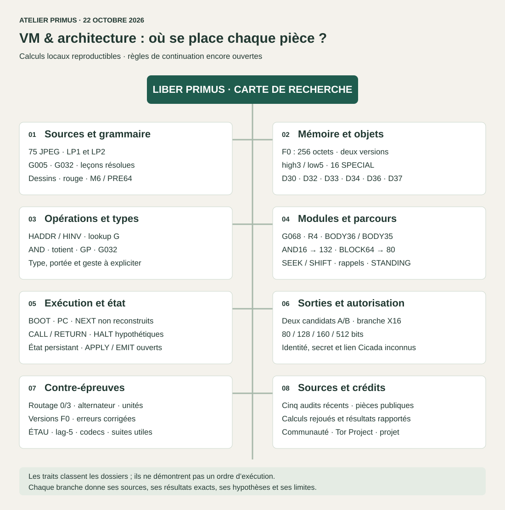

# VM et architecture — la carte complète du travail documenté

**MarcelDuSHAmp · Collaboration IA : ASTRA GPT-6**  
État croisé des rapports au **22 octobre 2026**. [Accueil du dépôt](../README.md) · [Parcours en dix minutes](../PARCOURS_10_MIN.md)

Nous cherchons si Liber Primus enseigne à construire puis à employer ses propres objets de lecture. Cette arborescence relie les sources, la mémoire F0, les lecteurs, les modules, les essais de machine et les sorties candidates. **Plusieurs compositions se calculent exactement ; une VM capable de choisir seule son instruction suivante n’est pas reconstruite.**



Les traits de cette carte organisent le dossier. Ils ne représentent pas un programme dont toutes les transitions seraient prouvées. Dans l’index HTML du dépôt, la rubrique **« Architecture / VM »** permet de déplier les branches et leurs dossiers sans connexion.

## Les huit branches

| Branche | Sous-branches et question traitée | Dossier |
|---|---|---|
| 01 · Sources et grammaire | 75 JPEG, LP1/LP2, textes résolus, G005, G032, dessins, rouge, M6/PRE64 | [Que nous apprend le livre ?](01-sources-et-grammaire.md) |
| 02 · Mémoire et objets | Deux F0, 32×8, high3/low5, 16 SPECIAL, familles D, D30/D32/D33/D34/D36/D37 | [Quels objets manipulons-nous ?](02-memoire-et-objets.md) |
| 03 · Opérations et types | HADDR, HINV, G, AND, totient, GP, lecteur G032, prélèvement/dépôt, conversions de type | [Que fait exactement chaque geste ?](03-operations-et-types.md) |
| 04 · Modules et parcours | G068, R4, BODY36/BODY35, AND16→132, BLOCK64→230→80, SEEK/SHIFT, STANDING | [Quelles compositions avons-nous essayées ?](04-modules-et-parcours.md) |
| 05 · Exécution et état | BOOT, PC, NEXT, registres, CALL/RETURN, HALT, modèle sans état, EMIT/APPLY | [Qu’est-ce qui ferait une vraie machine ?](05-execution-et-verrous.md) |
| 06 · Sorties et autorisation | A/B, X16, 80/128/160/512 bits, BASIC/STEALTH, client key, identité historique | [Vers quel objet extérieur ?](06-sorties-et-autorisation.md) |
| 07 · Contre-épreuves | Erreurs corrigées, routage 0/3, alternateur, segmentation, ÉTAU, lag-5, codecs, suites utiles | [Qu’est-ce qui échoue, et dans quel périmètre ?](07-refutations-et-tests.md) |
| 08 · Sources et crédits | Cinq audits récents, rapports du 21 octobre, fiches, provenance et limites du rejeu | [D’où vient chaque affirmation ?](SOURCES.md) |

## Lire les statuts sans confondre les niveaux

| Statut | Sens dans cette carte |
|---|---|
| SUPPORTÉ | Observation ou calcul reproduit dans son périmètre explicite. Ne prouve pas à lui seul une intention de Cicada. |
| HYPOTHÈSE | Fonction proposée : mémoire, configuration, appel, masque, contrôle, accès… |
| INDICE FAIBLE | Raccord intéressant, souvent rétrospectif, sans confirmation indépendante suffisante. |
| INCONCLUSIF | Informations ou règle manquantes ; mécanisme non départagé. |
| FALSIFIÉ | Modèle précisément défini contredit par un calcul ou une conséquence. Ne signifie pas « toutes les VM sont impossibles ». |

**Exemple concret.** `F0[105]=63` puis `HADDR(63)=249` est SUPPORTÉ. Appeler ce trajet `CALL D34` reste une HYPOTHÈSE : ni sauvegarde d’une adresse de retour, ni retour restauré ne sont établis. La différence est conservée sur la même branche, au lieu d’effacer le raccord ou de lui attribuer trop de sens.

## Rejouer et prolonger

```bash
python3 architecture/rejouer.py
python3 calculs/verifier_dossier.py
python3 calculs/reproduire_onion.py
```

Le [rejeu de la carte](rejouer.py) contrôle les deux binaires F0, les conversions, les cadres, les contre-exemples de routage et les exports A/B. Il écrit [resultats.json](resultats.json). Il ne retranscrit pas les runes et ne relance pas les archives Tor. Les chemins runiques dont la transcription complète n’est pas jointe gardent leur attribution aux rapports.

Le [modèle de navigation](modele.json) expose les branches et leurs liens. Il décrit le dossier ; ce n’est pas un microcode de Liber Primus. Les [171 fiches](../recherches/README.md) restent accessibles dans leurs 12 familles. La carte couvre les familles architecturales documentées et leurs impasses ; elle ne prétend pas contenir toutes les archives privées ni toutes les idées jamais essayées.

Deux suites utiles : chercher une commande indépendante de conversion/type sur un nouveau locus ; identifier le consommateur de 80 ou de 132 sans sélectionner sa destination après le calcul. L’exploration d’autres gestes reste ouverte ; seules les affirmations de validation demandent un contrôle indépendant.
